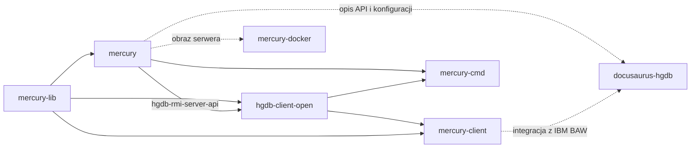

# Mercury DB (HgDB) – workspace IntelliJ

Repozytorium bazowe do analizy i rozwoju rozwiązania **Mercury DB (HgDB)**.
Nie zawiera kodu źródłowego. Spina w jeden projekt IntelliJ IDEA kilka niezależnych
repozytoriów git, które razem tworzą serwer, biblioteki współdzielone, klientów
i narzędzia systemu Mercury DB.

## Czym jest Mercury DB

Mercury DB (HgDB) to serwer usług **SOAP, REST i RMI** do zarządzania dowolnymi
obiektami, nazywanymi też *sprawami*. Silnik opiera się na relacyjnym modelu SQL
(PostgreSQL, Oracle, MySQL, MSSQL, HSQL), a dodatkowo indeksuje dane za pomocą
**Apache Lucene**. Dzięki temu system:

- działa jak obiektowa baza danych z transakcjami ACID,
- przechowuje metadane typów obiektów i sposobu ich prezentacji na formularzach,
- obsługuje dynamicznie zmieniający się model danych bez migracji struktur,
- integruje się z narzędziami BI oraz z IBM BPM (repozytorium danych dla aplikacji procesowych),
- pracuje w klastrze (węzły MASTER/SLAVE, ActiveMQ, Ehcache Clustered).

Produkt rozwija Sci Software Sławomir Cichy, a w wersji komercyjnej dystrybuuje go IBPM S.A.

## Struktura workspace

Repozytoria leżą obok siebie w `D:\workspace\git\`. IntelliJ odwołuje się
do nich ścieżkami względnymi `$PROJECT_DIR$/../<repo>`. Wyjątkiem jest `docusaurus-hgdb`:
to submoduł git repozytorium `scisoftware-webpage`, dostępny pod ścieżką
`$PROJECT_DIR$/../scisoftware-webpage/docusaurus-hgdb`.

| Repozytorium | Rola | GAV (projekt nadrzędny) | Dokumentacja |
|---|---|---|---|
| [`mercury-lib`](../mercury-lib) | Biblioteki współdzielone: rdzeń, encje, API usług, DTO | `io.hgdb.mercury:mercury-lib:3.0.4-SNAPSHOT` | [docs/moduly/mercury-lib.md](docs/moduly/mercury-lib.md) |
| [`mercury`](../mercury) | Serwer: DAO, Lucene, logika biznesowa, WS, GUI, aplikacje WAR | `io.hgdb:mercury:3.0.4.2` | [docs/moduly/mercury.md](docs/moduly/mercury.md) |
| [`hgdb-client-open`](../hgdb-client-open) | Publiczny klient Java (CXF, multi-instancja) | `io.hgdb.mercury:hgdb-client-open:3.1.4-SNAPSHOT` | [docs/moduly/hgdb-client-open.md](docs/moduly/hgdb-client-open.md) |
| [`mercury-client`](../mercury-client) | Biblioteki klienckie i integracje dla IBM BPM | `io.hgdb.ibmbpm:mercury-client:3.0.8.6-SNAPSHOT` | [docs/moduly/mercury-client.md](docs/moduly/mercury-client.md) |
| [`mercury-cmd`](../mercury-cmd) | Narzędzia linii komend, benchmark, transfer, pakiet instalacyjny | `io.hgdb.mercury:mercury-cmd:3.0.8.6-SNAPSHOT` | [docs/moduly/mercury-cmd.md](docs/moduly/mercury-cmd.md) |
| [`mercury-docker`](../mercury-docker) | Obrazy i kompozycje Docker, wykresy Helm | – (nie jest projektem Maven) | [docs/moduly/mercury-docker.md](docs/moduly/mercury-docker.md) |
| [`docusaurus-hgdb`](../scisoftware-webpage/docusaurus-hgdb) | Serwis [hgdb.org](https://hgdb.org): dokumentacja produktu, wsparcie techniczne, blog (Docusaurus 3) | – (projekt Node.js) | [docs/moduly/docusaurus-hgdb.md](docs/moduly/docusaurus-hgdb.md) |

Repozytoria zależą od siebie w następującym kierunku:

Linie przerywane oznaczają powiązania inne niż zależności Maven.

Szczegóły warstw, zależności i kolejności budowania opisuje
[docs/architektura.md](docs/architektura.md).

## Moduły

Pięć repozytoriów Maven zawiera razem 45 modułów: 41 w reaktorach i 4 poza nimi
(oznaczone ⚠️). `mercury-client-cmd` jest zaimportowany w IntelliJ jako osobny projekt
Maven (📦). Pełne opisy są w plikach `docs/moduly/`.

### mercury-lib – biblioteki współdzielone

| Moduł | Opis |
|---|---|
| `mercury-core` | Bazowe typy encji, atrybuty, wyjątki. Nie zależy od innych modułów |
| `mercury-entities-dto-generator` | Generator klas DTO z klas encji |
| `mercury-entities` | Implementacje encji (część źródeł generowana) |
| `mercury-srv-api` | Interfejsy warstwy logiki i biznesu |
| `mercury-ws-dto-api` | Obiekty transportowe usług SOAP/REST |
| `mercury-ws-server-api` | Interfejsy usług SOAP/REST (CXF) |
| `mercury-spring-remoting` | Kopia wycofanego ze Springa HTTP invokera |
| `maven` ⚠️ | Pomocniczy POM spoza reaktora |

### mercury – serwer

| Obszar | Moduły |
|---|---|
| Rdzeń i dane | `mercury-core-server` (konektory, bazowe DAO), `mercury-entities-ids` (sekwencje i identyfikatory), `mercury-dao-api`, `mercury-dao` (Hibernate, cache), `mercury-mock` (dane testowe) |
| Wyszukiwanie i integracje | `mercury-lucene-indexes-api`, `mercury-lucene-indexes`, `mercury-cmis-client` (Alfresco, FileNet, SharePoint) |
| Logika | `mercury-srv` (logika, biznes, JMS), `mercury-srv-slave` (węzły klastra SLAVE) |
| Usługi | `mercury-ws-server` (SOAP, RMI), `mercury-ws-server-api20` i `mercury-ws-server-api20-generator` (zgodność z API 2.0), `mercury-ws-app-rest-generator` (REST z SOAP), `hgdb-rmi-server-api` |
| Aplikacje i GUI | `mercury-ws-app` (główny WAR), `mercury-gui-registry` (WAR), `license-registry` (WAR), `ROOT` (WAR), `mercury-gui-core` (Realm RDBMS/LDAP, OAuth 2.0) |
| Narzędzia | `hgdb-tools` (licencje), `hgdb-server-monitor`, `mercury-server` (testowy Tomcat 8.0.32 z ActiveMQ) |
| Poza reaktorem ⚠️ | `maven` (`pl.slawas:install-jar`, instalacja jarów w lokalnym repozytorium) |

### hgdb-client-open – publiczny klient Java

| Moduł | Opis |
|---|---|
| `hgdb-client-mock` | Generatory danych do testów klienta |
| `hgdb-ws-client-cxf` | Klient usług SOAP (CXF) do jednej instancji serwera |
| `hgdb-multi-client` | Klient wielu instancji (klaster), przez HTTP invoker i RMI |

### mercury-client – integracje z IBM BPM

| Moduł | Opis |
|---|---|
| `mercury-client-mock` | Generatory danych do testów klienta |
| `mercury-bpm` | Główna biblioteka dla IBM BPM: akcje i mapowanie obiektów |
| `mercury-bpm-fix` | Elementy usunięte z `mercury-bpm`, zachowane dla zgodności wstecz |
| `mercury-integrations` | Implementacja integracji IBM BPM z Mercury DB |
| `mercury-client-cmd` ⚠️ 📦 | Polecenia CLI klienta BPM i instalacja bibliotek w `Lombardi/lib` serwera IBM BPM. Budowany osobno, wersja `3.20.8-SNAPSHOT` |
| `mercury-data` ⚠️ | Szablon „Hello world” z nieaktualną zależnością. Poza reaktorem |

### mercury-cmd – narzędzia linii komend

| Moduł | Opis |
|---|---|
| `mercury-srv-cmd` | Polecenia CLI serwera: kodowanie haseł, synchronizacja typów, generowanie i walidacja indeksów Lucene, test JDBC |
| `mercury-transfer` | Kopiowanie danych wybranego typu między dwiema instancjami serwera |
| `mercury-benchmark` | Testy wydajności (kod w `src/test`) |
| `mercury-install-package` | Pakiet instalacyjny serwera: Tomcat 8.5.14, skrypty startowe, SQL, konfiguracja |

### mercury-docker – wdrożenie

- Obrazy: `mercury-3.0` (serwer), `mercury-lb` (Nginx), `postgresql`, `activemq`, `ehcache`, `openldap`, `poi-server`.
- Kompozycje: `mercury-single-node`, `mercury-two-node-cluster`, `mercury-three-node-cluster`.
- Helm: `charts/mercury-single-node`.

### docusaurus-hgdb – serwis hgdb.org

| Sekcja | Ścieżka | Zawartość |
|---|---|---|
| Documentation | `docs/` | Wprowadzenie, „Case vs Object”, architektura (metadane, wersjonowanie, Lucene, uprawnienia), API, konfiguracja, integracja z IBM BAW |
| Technical Support | `tech/` | Wersje Mercury, opisy kodów błędów (`errorCode`) |
| Blog | `blog/` | Wpisy (obecnie jeden) |
| Tłumaczenia | `i18n/pl` | Polska wersja dokumentacji i wsparcia. Językiem domyślnym jest angielski |

## Pliki w tym repozytorium

| Ścieżka | Zawartość |
|---|---|
| `.idea/misc.xml` | Lista zaimportowanych projektów Maven: `mercury`, `mercury-lib`, `mercury-client`, `mercury-cmd`, `hgdb-client-open` oraz osobno `mercury-client/mercury-client-cmd` i `mercury-cmd/mercury-install-package` |
| `.idea/modules.xml` | Moduły dodane ręcznie (`docusaurus-hgdb`, `mercury-docker`, ten workspace). Moduły Maven IntelliJ trzyma w swoim katalogu systemowym (`ExternalStorageConfigurationManager`) |
| `.idea/vcs.xml` | Mapowanie repozytoriów git |
| `.idea/jarRepositories.xml` | Lokalne repozytoria Maven poszczególnych projektów (`<repo>/repo`) |
| `.idea/compiler.xml`, `.idea/encodings.xml` | Ustawienia kompilatora i kodowania (UTF-8) dla modułów |
| `docs/` | Dokumentacja architektury, modułów i obserwacji z analizy |

## Indeksy Lucene do testów wydajności

Poza workspace, w `H:\mercury`, leżą gotowe indeksy Lucene (stan na 2026-10-25):

| Ścieżka | Model wyszukiwania | Rozmiar | Uwagi |
|---|---|---|---|
| `H:\mercury\20190705_Case_3.0` | **3.0** (najważniejszy dla bieżących zadań) | 6,8 GB | Katalog `Case`; archiwum `.tar.gz` obok |
| `H:\mercury\20190405_Case.2.0.tar.gz` | 2.0 | archiwum 4,5 GB (rozpakowany 6,9 GB) | Rozpakowany: `F:\mercury-indexes\20190405_Case.2.0`. Powiązania w starym formacie `subCaseIds`, zapytania z dziećmi nie działają (zadanie 75) |
| `H:\mercury\lucene-INEA\index`, `lucene-test-mercury-3.0-2.1` | nie sprawdzono | | |
| `H:\mercury\INEA_createDate.json` / `.txt` | | 25 MB (txt) | Statystyka liczby spraw na dzień (`statisticsPerDay`, od 2016-06-01) |

Kopie robocze (szybszy dysk): `F:\mercury-indexes` (`20190705_Case_3.0`, `20190405_Case.2.0` z archiwum, `INEA_createDate.json`). Oryginały na `H:` nie są modyfikowane.

Używaj ich do pomiarów (zadanie 119), obok indeksu wygenerowanego testem `LuceneVolumeTest`
(`mercury/integrations/lucene/perf-100k`). Pochodzenie indeksów i dokładny model pól to przypuszczenie, do sprawdzenia.

## Szybki start

1. Sklonuj wszystkie repozytoria z tabeli do jednego katalogu (domyślnie `D:\workspace\git`).
   `docusaurus-hgdb` pobierz jako submoduł: `git clone --recurse-submodules` repozytorium `scisoftware-webpage`.
2. Skonfiguruj Maven `settings.xml` i ustaw w aktywnym profilu właściwości:
   `local-project-workspace-path`, `local-lib-path`, `local-java-home-path`,
   `local-java-naming-provider-url`. Przykłady są w `repo/settings.xml` i `maven/<user>/settings.xml`
   w poszczególnych repozytoriach.
3. Otwórz ten katalog w IntelliJ IDEA i zaimportuj projekty Maven.
4. Zbuduj repozytoria w kolejności `mercury-lib` → `mercury` → `hgdb-client-open` →
   `mercury-client` / `mercury-cmd` (patrz [docs/architektura.md](docs/architektura.md#kolejność-budowania)).
5. Opcjonalnie uruchom serwis dokumentacji: w `docusaurus-hgdb` wykonaj `npm install`, potem `npm start`.

## Dokumentacja

- [Architektura i zależności](docs/architektura.md)
- Moduły: [mercury-lib](docs/moduly/mercury-lib.md) ·
  [mercury](docs/moduly/mercury.md) ·
  [hgdb-client-open](docs/moduly/hgdb-client-open.md) ·
  [mercury-client](docs/moduly/mercury-client.md) ·
  [mercury-cmd](docs/moduly/mercury-cmd.md) ·
  [mercury-docker](docs/moduly/mercury-docker.md) ·
  [docusaurus-hgdb](docs/moduly/docusaurus-hgdb.md)
- [Wydanie 3.0.4.2 – zmiana formatu XML i kontrola wersji węzłów](docs/wydanie-3.0.4.2.md)
- [Obserwacje z analizy i kandydaci do udoskonaleń](docs/obserwacje.md)

## Licencja

Biblioteki klienckie i współdzielone: [HGDB Client License 1.0](http://hgdb.io/HGDB_Client_LICENSE.1.0.txt).
Serwer: © Sci Software Sławomir Cichy, wszystkie prawa zastrzeżone.
