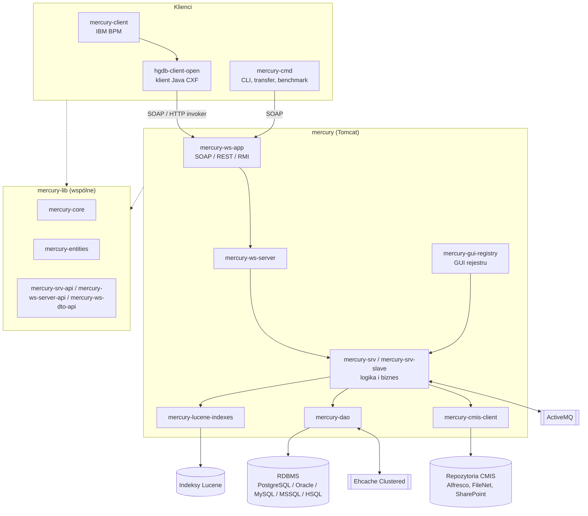

# Architektura rozwiązania Mercury DB

## Warstwy



- **mercury-lib** to kontrakt współdzielony przez serwer i klientów: encje, interfejsy
  warstwy logiki i biznesu, interfejsy usług WS i obiekty DTO.
- **mercury** zawiera implementację tego kontraktu: dostęp do danych (Hibernate), indeksy
  Lucene, logikę biznesową, usługi CXF (SOAP/REST) i Spring remoting (RMI / HTTP invoker),
  GUI oraz aplikacje WAR uruchamiane w Tomcacie.
- **hgdb-client-open** to klient Java usług serwera. Obsługuje też wiele instancji (klaster).
- **mercury-client** i **mercury-cmd** to rozwiązania zbudowane na klientach: integracje
  z IBM BPM i narzędzia administracyjne.
- **mercury-docker** i **docusaurus-hgdb** nie zawierają kodu Java. Pierwsze definiuje obrazy
  i kompozycje do wdrożenia serwera, drugie to serwis [hgdb.org](https://hgdb.org)
  z dokumentacją API, konfiguracji i integracji z IBM BAW.

## Zależności między repozytoriami

| Repozytorium | Zależy od (repozytoria workspace) | Zależności zewnętrzne autora |
|---|---|---|
| mercury-lib | – | `sccommon-utils`, `sccommon-cache`, `sccommon-eclipse-emf-api` |
| mercury | mercury-lib | `sccommon-*` (utils, cache, ldap, mail, http-client, eclipse-emf-api), `ccrto-openapi`, `poi-toolkit` |
| hgdb-client-open | mercury-lib, mercury (`hgdb-rmi-server-api`) | `sccommon-utils`, `sccommon-cache`, `ccrto-openapi`, `poi-toolkit` |
| mercury-client | mercury-lib, hgdb-client-open (`hgdb-ws-client-cxf`, `hgdb-multi-client`) | `sccommon-*`, `tw4j`, biblioteki IBM BPM / WebSphere |
| mercury-cmd | mercury-lib, mercury, hgdb-client-open | `sccommon-*`, `ccrto-openapi` |

Biblioteki `sccommon`, `ccrto-openapi` i `poi-toolkit` też pochodzą od autora. Leżą
w `D:\workspace\git` (`sccommon`, `ccrto-openapi`, `poi-toolkit`), ale nie są częścią tego workspace.

Każde repozytorium ma własne lokalne repozytorium Maven (`<repo>/repo`), skonfigurowane
w `.idea/jarRepositories.xml`. Artefakty przekazuje się między projektami skryptami
`install.sh` / `deploy.sh` / `deploy-api.sh`. Repozytorium publiczne:
`https://nexusrepo.scisoftware.pl/repository/sci-maven-releases`.

## Kolejność budowania

1. **mercury-lib**, z parametrem wersji i dostawcy bazy:
   ```bash
   mvn clean install -Dmercury.static.version=<wersja> -Ddatabse.provider=POSTGRESQL -Dmaven.test.skip
   ```
2. **mercury** (serwer):
   ```bash
   mvn -U clean install -Dmaven.test.skip=true [-Ddatabse.provider=ORACLE|MYSQL]
   ```
3. **hgdb-client-open**:
   ```bash
   mvn $MAVEN_SETTINGS clean install -Dmaven.test.skip
   ```
4. **mercury-client**: wymaga dostępu do bibliotek IBM BPM. README zaleca Javę 1.6/1.7
   i Maven 2.2.1, a POM ustawia `java.version=1.8`. Moduł `mercury-client-cmd` buduje się
   osobno, z jego katalogu.
5. **mercury-cmd**: buduje narzędzia oraz pakiet instalacyjny serwera.
6. **docusaurus-hgdb** (niezależnie od powyższych): `npm install && npm run build`.

Kolejność modułów w reaktorze `mercury` (z `mercury/README.md`):
core-server → entities-ids → dao-api → mock → dao → cmis-client → lucene-indexes-api →
lucene-indexes → srv → ws-server-api20-generator → ws-server-api20 → ws-server → gui-core →
gui-registry → srv-slave → ws-app-rest-generator → ws-app → server.

## Dostawca bazy danych

Encje i biblioteki buduje się osobno dla każdego dostawcy RDBMS. Steruje tym właściwość
`databse.provider` (nazwa z literówką, celowo zachowana w POM-ach):
`POSTGRESQL` (domyślny), `ORACLE`, `MYSQL`, `MSSQL`, `HSQL`.
Na tej podstawie powstaje wersja artefaktu encji, np. `mercury-entities.version=${databse.provider}-${mercury.static.version}`.

## Wersjonowanie

Wersja ma pięć pozycji (opis z `mercury-lib/README.md`):

1. i 2. Wartości specyficzne dla produktu. Ich zmiana oznacza zmianę nazwy produktu.
3. Poważna zmiana: nowe podejście, aktualizacja Javy i zależności. Wymaga aktualizacji klientów i serwera.
4. Zmiana API (SOAP lub REST). Wymaga aktualizacji klientów i serwera.
5. Drobna zmiana. Wymaga aktualizacji tylko po stronie serwera.

## Stos technologiczny (wg POM-ów)

| Obszar | mercury (serwer) | mercury-lib | hgdb-client-open | mercury-client |
|---|---|---|---|---|
| Java | 1.8 | 1.8 | 1.8 | 1.8 wg POM (README: 1.6 / 1.7) |
| Spring | 5.3.20 | 2.5.6 | 5.3.21 | 4.1.9.RELEASE |
| Apache CXF | 3.0.12 | 3.0.10 | 3.0.10 | 2.7.15 |
| Hibernate | 5.6.14.Final | – (JPA 2.1) | – | – |
| Lucene | 7.5.0 | – | – | – |
| Ehcache | 3.6.1 | 3.6.1 | 2.10.1 | 2.10.1 |
| Logowanie | slf4j 1.7.36 + Logback 1.2.13 | slf4j 1.7.36 + Logback 1.2.13 | slf4j 1.7.36 + Logback 1.2.13 | slf4j 1.7.36 + Logback 1.2.13 |
| Serwer aplikacji | Tomcat 8.0.32 (`mercury-server`) | – | – | IBM WebSphere 8.5.5 |
| Inne | ActiveMQ 5.16, OpenCMIS 1.1.0, POI 5.2.1, Jackson 2.13 | POI 5.2.1, Jackson 2.12 | – | IBM BPM 8.6.3, Axis 1.4 |
