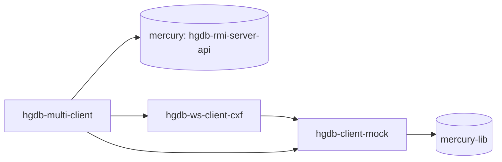

# hgdb-client-open – publiczny klient Java

| | |
|---|---|
| Lokalizacja | `D:\workspace\git\hgdb-client-open` |
| GAV | `io.hgdb.mercury:hgdb-client-open:3.1.4-SNAPSHOT` (pom) |
| Java | 1.8 |
| Opis z POM | Zbiór integracji z IBM BPM i nie tylko do komunikacji z serwerem bazy Mercury. |
| Licencja | [HGDB Client License 1.0](http://hgdb.io/HGDB_Client_LICENSE.1.0.txt) |

Publiczny klient Java usług serwera Mercury DB. Daje zdalny dostęp do metod warstwy logiki
(logic) i biznesu (business) zdefiniowanych w `mercury-lib`. Z klienta korzystają
`mercury-client` (IBM BPM) i `mercury-cmd` (narzędzia CLI).

Projekt nadrzędny dołącza do wszystkich modułów biblioteki z `mercury-lib`: `mercury-core`,
`mercury-entities`, `mercury-srv-api`, `mercury-ws-dto-api`, `mercury-ws-server-api`
i `mercury-spring-remoting`.

## Moduły

| Moduł | Nazwa | Pliki Java (main / test) | Główne pakiety | Opis |
|---|---|---|---|---|
| `hgdb-client-mock` | Mock Client | 47 / 0 | `io.hgdb.mercury.client.mock.data`, `.attr`, `.dict`, `io.hgdb.mercury.client.test` | Generatory danych do testów klienta. |
| `hgdb-ws-client-cxf` | WS Client CXF | 66 / 5 | `io.hgdb.mercury.client.cxf.logic`, `.business` | Klient usług SOAP (Apache CXF) do jednej instancji serwera. |
| `hgdb-multi-client` | Multi Client CXF | 65 / 2 | `io.hgdb.multi.client.cxf.logic`, `.business`, `io.hgdb.multi.client.registry` | Klient wielu instancji bazy (klaster). Rejestr dynamicznych proxy HTTP invokera i RMI (`HttpInvokerProxyFactoryDynamicRegistry`, `RmiProxyFactoryDynamicRegistry`) z obsługą błędów per instancja. |

## Zależności wewnętrzne



`hgdb-ws-client-cxf` zależy dodatkowo od `pro.ibpm:tw4j` (biblioteka dla IBM BPM).

## Stos technologiczny

Spring 5.3.21, Apache CXF 3.0.10, Ehcache 2.10.1, log4j 1.2.14, slf4j 1.7.25,
`sccommon` 1.0.8.4-jdk1.7, `ccrto-openapi` 1.2-SNAPSHOT. Wersja serwera, z którą klient
jest zgodny: `mercury.project.version=3.0.4.1`.

## Budowanie

```bash
export USER_NAME=slawas
export MAVEN_SETTINGS="--global-settings \"repo/settings.xml\" --settings \"maven/$USER_NAME/settings.xml\""
mvn $MAVEN_SETTINGS clean install -Dmaven.test.skip
```

- Biblioteki trafiają do `repo/io/hgdb/mercury/<moduł>`.
- `install.sh` ustawia wersję z `minor_version.txt` (`mvn versions:set`), buduje pakiet
  dla `POSTGRESQL` i kopiuje POM-y do lokalnego repozytorium.
- `deploy.sh` publikuje artefakty do Nexusa SCI Software (`sci-maven-releases`).
- `up_major_version.sh` podnosi wersję.
- Testy wymagają działającego serwera Mercury DB. Konfiguracja:
  `hgdb-ws-client-cxf/src/test/resources-filtered/properties/<user>/test.properties`.

Źródło: `hgdb-client-open/README.txt`, POM-y projektu.
