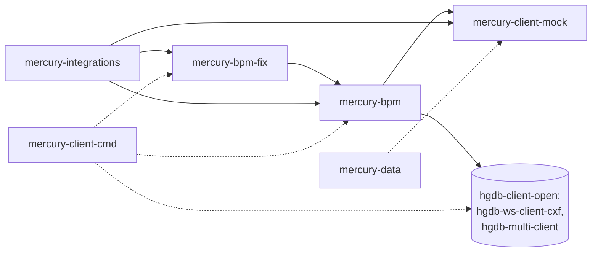

# mercury-client – biblioteki klienckie dla IBM BPM

| | |
|---|---|
| Lokalizacja | `D:\workspace\git\mercury-client` |
| GAV | `io.hgdb.ibmbpm:mercury-client:3.0.8.6-SNAPSHOT` (pom) |
| Java | 1.8 wg POM (`java.version`); README wymaga Javy 1.6 / 1.7 i Maven 2.2.1 |
| Opis z POM | Zbiór integracji z IBM BPM i nie tylko do komunikacji z serwerem bazy Mercury. Biblioteki realizowane na zlecenie firmy IBPM S.A. |

Biblioteki klienta Mercury DB używane w aplikacjach procesowych IBM BPM. Działają na
klientach z `hgdb-client-open`. Moduły mają GAV `io.hgdb.ibmbpm:<moduł>:3.0.8.6-SNAPSHOT`,
chyba że w tabeli podano inaczej.

Projekt nadrzędny dołącza do wszystkich modułów `pro.ibpm:tw4j` oraz biblioteki z
`mercury-lib`: `mercury-core`, `mercury-entities`, `mercury-srv-api`, `mercury-ws-dto-api`,
`mercury-ws-server-api`.

## Moduły

| Moduł | Nazwa | Pliki Java (main / test) | Główne pakiety | Opis |
|---|---|---|---|---|
| `mercury-client-mock` | Mock Client | 57 / 0 | `pro.ibpm.mercury.mock.data`, `.arch`, `.attr`, `.dict` | Generatory danych do testów klienta. |
| `mercury-bpm` | BPM | 299 / 46 | `pro.ibpm.mercury.bpm.mappers`, `pro.ibpm.mercury.bpm.actions` | Główna biblioteka dla IBM BPM. Akcje wywoływane z procesów i mapowanie obiektów Mercury na typy BPM. |
| `mercury-bpm-fix` | BPM Fix | 2 / 0 | `pro.ibpm.mercury.bpm.actions` | Elementy usunięte z `mercury-bpm`, zachowane dla zgodności wstecz (`KTMNumberBPMAction`). |
| `mercury-integrations` | BPM Integrations | 45 / 26 | `pro.ibpm.mercury.integrations.bpm`, `pro.ibpm.bpm.utils` | Implementacja integracji IBM BPM z Mercury DB. |
| `mercury-client-cmd` ⚠️ | mercury-client-cmd | 10 / 0 | `pro.ibpm.mercury.cmd` | Polecenia CLI klienta BPM i pakiet instalacji bibliotek klienta na serwerze IBM BPM. Opis w sekcji [mercury-client-cmd](#mercury-client-cmd). **Poza reaktorem**, w IntelliJ zaimportowany jako osobny projekt Maven. |
| `mercury-data` ⚠️ | mercury-data | 1 / 2 | `org.mercury.data` | Szablon Maven („Hello world”). **Poza reaktorem.** Zależy od nieistniejącego artefaktu `mercury-ws-client-cxf`. |

## Zależności wewnętrzne



Linie przerywane oznaczają moduły spoza reaktora.

## mercury-client-cmd

| | |
|---|---|
| GAV | `io.hgdb.ibmbpm:mercury-client-cmd:3.20.8-SNAPSHOT` |
| Rodzic | `io.hgdb.ibmbpm:mercury-client:3.20.8-SNAPSHOT` |
| Budowanie | Osobno, poza reaktorem `mercury-client`. W IntelliJ zaimportowany jako osobny projekt Maven (`.idea/misc.xml`) |

Moduł ma dwie role:

1. **Narzędzie CLI** (`pro.ibpm.mercury.cmd.Client`) z akcjami `-ep` (kodowanie hasła),
   `-?` (pomoc) i trybem shell. Uruchamia się je skryptami `src/main/bin/startApp.sh` / `.bat`.
   Konfiguracja leży w `src/main/conf`: `client.properties`, `mercury.properties`,
   `lucene.properties`, `log4j.properties`.
2. **Pakiet instalacyjny bibliotek klienta** dla serwera IBM BPM (`src/main/build/build-installation.xml`).
   Właściwość `artifactIdsMaps` wskazuje, które biblioteki trafiają do katalogu `Lombardi/lib`
   i w jakim trybie: `B` – BPM, `S` – klient/serwer. Lista jest podzielona na grupy z prefiksem
   (np. `0_`). Prefiks jest doklejany do nazw bibliotek i służy jako maska: pliki o takich
   nazwach są usuwane z katalogu przed instalacją. Lista obejmuje biblioteki `mercury-lib`,
   `mercury-bpm`, `mercury-bpm-fix`, `hgdb-ws-client-cxf`, `hgdb-multi-client`, Springa,
   Ehcache, `sccommon` i `scteamworks-log4j`.

Większość zależności ma zakres `provided`, bo w środowisku IBM BPM dostarcza je serwer
albo pakiet instalacyjny. Wyjątkiem są klienci `hgdb-ws-client-cxf`, `hgdb-multi-client`
w wersji `${hgdb-client.version}` i moduły Springa.

Wersja rodzica (`3.20.8-SNAPSHOT`) różni się od bieżącej wersji `mercury-client`
(`3.0.8.6-SNAPSHOT`), dlatego Maven nie bierze rodzica z `../pom.xml`. Pobiera go z lokalnego
repozytorium projektu: `mercury-client/repo/io/hgdb/ibmbpm/mercury-client/3.20.8-SNAPSHOT`.
Stamtąd pochodzą też właściwości, np. `hgdb-client.version`, której bieżący `pom.xml`
już nie definiuje.

## Stos technologiczny

IBM BPM 8.6.3 (`tw4j` 8.6.3.21030.2.0.3.20230127), IBM WebSphere 8.5.5.22, Spring 4.1.9.RELEASE,
Apache CXF 2.7.15, Ehcache 2.10.1, POI 3.9, log4j 1.2.14, Jackson 2.5.3, JUnit 4.7.

## Budowanie

Wymagania:

- Biblioteki `mercury-lib` zainstalowane w lokalnym repozytorium projektu
  (w `mercury-lib`: `./install.sh slawas mercury-client deployAll`).
- Dostęp do bibliotek IBM BPM i WebSphere. Są chronione licencją IBM i nie wolno ich
  rozpowszechniać. Ładują je skrypty `01_install_teamworks_libs.sh <wersja>` (biblioteki
  Lombardi/TeamWorks) i `02_install_websphere_libs.sh <wersja>`. Ścieżkę repozytorium
  podaje właściwość `ibm-lib-local-repository`.

```bash
export MAVEN_SETTINGS="--global-settings \"repo/settings.xml\" --settings \"maven/slawas/settings.xml\""
mvnibm $MAVEN_SETTINGS clean install -Dmaven.test.skip
```

- `mvnibm` to Maven 2.2.1 z `JAVA_HOME` ustawionym na IBM Java.
- Biblioteki trafiają do `repo/io/hgdb/ibmbpm`.
- `install.sh` ustawia wersję z `minor_version.txt` i instaluje pakiet dla `POSTGRESQL`.
- Profil `skipInstall` pomija instalację artefaktów.
- `mercury-bpm-fix` jest w reaktorze, ale w `pom.xml` jest oznaczony komentarzem
  „To musi być budowane osobno!!!”.
- `mercury-client-cmd` buduje się osobno, z jego katalogu: `mvn clean install`.

## Pozostałe katalogi

- `conf/`, `conf-inea/` – przykładowe konfiguracje klienta (`conf-inea` dla wdrożenia INEA).- `documents/` – dokumentacja.
- `maven-ibm-lib-repo/` – lokalne repozytorium bibliotek IBM.

Źródło: `mercury-client/README.txt`, POM-y projektu.
