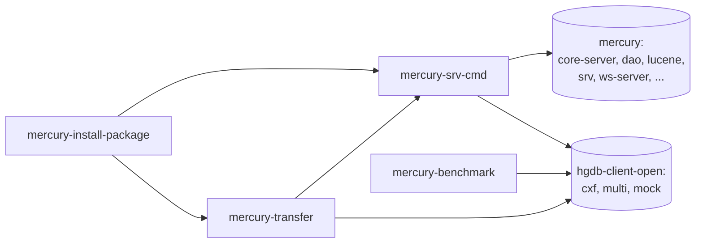

# mercury-cmd – narzędzia linii komend

| | |
|---|---|
| Lokalizacja | `D:\workspace\git\mercury-cmd` |
| GAV | `io.hgdb.mercury:mercury-cmd:3.0.8.6-SNAPSHOT` (pom) |
| Java | 1.8 |
| Opis z POM | System uniwersalnego źródła danych. |

Narzędzia administracyjne serwera Mercury DB: polecenia CLI, transfer danych między
instancjami, testy wydajności i pakiet instalacyjny serwera. Moduły mają GAV
`io.hgdb.mercury:<moduł>:3.0.8.6-SNAPSHOT`.

Projekt korzysta z wydanych wersji pozostałych repozytoriów, a nie z bieżących snapshotów:
`mercury.static.version=3.0.3.2.12` (serwer i `mercury-lib`), `hgdb-client.version=3.1.2.0.2`.

## Moduły

| Moduł | Typ | Pliki Java (main / test) | Główne pakiety | Opis |
|---|---|---|---|---|
| `mercury-srv-cmd` | jar | 18 / 0 | `pro.ibpm.mercury.cmd`, `org.mercury.cmd.config` | Polecenia CLI serwera (`CommandLine`). Działa lokalnie, na bibliotekach serwera (`command-local-context.xml`), albo zdalnie, przez klienta (`command-remote-context.xml`). |
| `mercury-transfer` | jar | 5 / 3 | `org.mercury.transfer.cmd` | Kopiuje dane wybranego typu między dwiema instancjami Mercury DB, wielowątkowo (`TransferThread`). |
| `mercury-benchmark` | jar | 1 / 6 | `org.mercury.benchmark` | Testy wydajności. Właściwy kod jest w testach (`BenchmarkTest`, `SequenceTest`, wątki wyszukiwania Lucene). `App.java` to szablon „Hello world”. |
| `mercury-install-package` | pom | – | – | Buduje pakiet instalacyjny serwera (`maven-antrun-plugin`, `build-installation.xml`). |

### Polecenia `mercury-srv-cmd`

| Kod | Akcja | Opis |
|---|---|---|
| `EP` | `EncodePasswordAction` | Kodowanie hasła do plików konfiguracyjnych. |
| `TS` | `TypesSynchronization` | Synchronizacja typów dokumentów z repozytorium. |
| `GL` | `GenerateLuceneAction` | Generowanie indeksu Lucene dla encji (opcjonalnie liczba wątków). |
| `RIC` | `ReindexCaseAction` | Ponowne indeksowanie spraw w zakresie numerów SCN. |
| `VL` | `GenerateLuceneAction` (walidacja) | Walidacja encji o podanej nazwie. |
| `RPD` | `ReloadPredefinedParamDefinitionsAction` | Przeładowanie predefiniowanych definicji parametrów. |
| `JDBCTEST` | `JdbcConnectionAction` | Test połączenia z bazą SQL. |
| `HELP` | `HelpAction` | Pomoc. |

### Zawartość pakietu instalacyjnego

| Katalog | Zawartość |
|---|---|
| `src/main/bin` | `startup.sh`, `shutdown.sh`, `mercury-server.sh`, `mercury-cmd.sh`, `mercury-transfer.sh`, `mercury-ports.sh` |
| `src/main/config` | Konfiguracja CLI i transferu, log4j, komunikaty i etykiety w sześciu językach (pl, en, de, es, fr, ko) |
| `src/main/scripts` | Skrypty SQL: inicjalizacja baz Mercury, ActiveMQ i LDAP, role i użytkownicy, schematy LDAP (DB2, MySQL, Oracle, PostgreSQL), migracje do 2.0 i z 2.0 do 3.0 |
| `src/main/installableApps` | `setwebconf.sh` |
| `bin/` | Apache Tomcat 8.5.14 i instalatory JDK 8 (u112 Windows, u131 Linux) |
| `releases/` | Zbudowane pakiety, np. `mercury-install-package-3.0.3.2.11.POSTGRESQL.20221006.zip` |
| `system-config-sample/linux` | Przykładowa konfiguracja systemu |
| `libExt/` | `fscontext`, `providerutil` (JNDI w systemie plików) |

## Zależności wewnętrzne



## Stos technologiczny

Spring 5.3.20, Hibernate 5.4.24.Final, Lucene 7.5.0, Apache CXF 3.0.10, Ehcache 3.6.1,
ActiveMQ 5.16.2, POI 5.2.1, OpenCMIS 1.1.0, Jackson 2.13.2, slf4j 1.7.36 + log4j 2.17.2.

## Budowanie

Projekt nie ma README ani skryptów instalacyjnych w katalogu głównym. Buduje się go
standardowo, po zainstalowaniu `mercury-lib`, `mercury` i `hgdb-client-open` w wersjach
podanych wyżej:

```bash
mvn clean install -Dmaven.test.skip
```

Testy `mercury-benchmark` i `mercury-transfer` wymagają działającego serwera. Konfiguracja:
`mercury-benchmark/src/test/resources-filtered/properties/<user>/test.properties`
i `test-transfer.properties`.

Źródło: POM-y i kod projektu.
