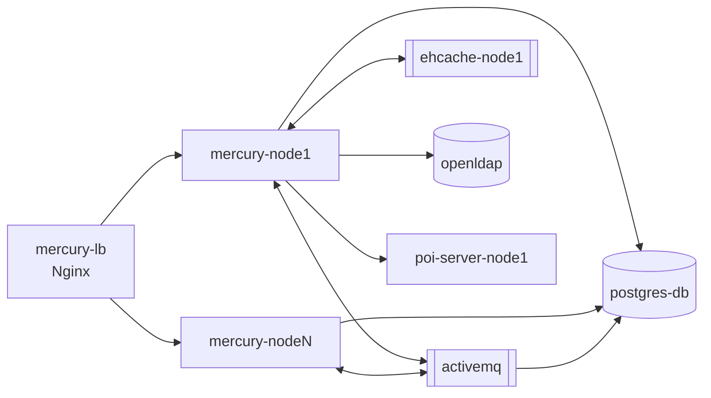

# mercury-docker – obrazy Docker i wykresy Helm

| | |
|---|---|
| Lokalizacja | `D:\workspace\git\mercury-docker` |
| Typ | Projekt ogólny IntelliJ (`mercury-docker.iml`), nie jest projektem Maven |
| Wersja serwera | `3.0.3.2.11` |
| Źródła | `github.com/IBPM-S-A/mercury-docker`, `github.com/SciSoftwareSlawomirCichy/mercury-docker` |

Definicje obrazów i kompozycji Docker do uruchomienia Mercury DB jako pojedynczego węzła
lub klastra, oraz wykres Helm dla Kubernetes. Obrazy są publikowane w Docker Hub
w przestrzeni `ibpm/`.

## Obrazy

| Katalog | Obraz | Baza | Opis |
|---|---|---|---|
| `mercury-3.0` | `ibpm/mercury:mercury-hgdb-3.0.3.2.11` | CentOS 8 | Serwer Mercury DB (Tomcat z aplikacjami serwera). |
| `mercury-lb` | `ibpm/mercury-lb:mercury-hgdb-3.0` | CentOS 8 | Nginx jako reverse proxy i load balancer węzłów klastra. Zawiera centrum certyfikatów. |
| `postgresql` | `ibpm/postgres:mercury-hgdb-3.0` | – | Baza danych serwera i ActiveMQ. |
| `activemq` | `ibpm/activemq:mercury-hgdb-3.0` | – | Broker JMS do komunikacji między węzłami. |
| `ehcache` | `ibpm/ehcache:mercury-hgdb-3.0` | Oracle JDK 8 | Serwer Ehcache Clustered. Konfigurację wybierają zmienne `HGDB_NODE` (`node1`–`node3`) i `HGDB_NODES` (1–3). |
| `openldap` | `ibpm/openldap:mercury-hgdb-3.0` | – | Katalog użytkowników. |
| `poi-server` | `ibpm/poi-server:mercury-hgdb-3.0` | Oracle JDK 8 | Iron – POI Excel Server: import i eksport danych w formacie xlsx. Węzeł wybiera zmienna `HGDB_NODE`. |

## Kompozycje

| Katalog | Węzły Mercury | Usługi |
|---|---|---|
| `mercury-single-node` | 1 | `mercury` (LB), `postgres-db`, `activemq`, `openldap`, `ehcache-node1`, `poi-server-node1`, `mercury-node1` |
| `mercury-two-node-cluster` | 2 | jak wyżej, z `ehcache-`, `poi-server-` i `mercury-node1..2` |
| `mercury-three-node-cluster` | 3 | jak wyżej, z `ehcache-`, `poi-server-` i `mercury-node1..3` |

Każdy węzeł ma własne wolumeny `mercury-upload-N` i `mercury-lucene-N` (indeksy Lucene).
Katalogi `activemq` i `poi-server` mają też własne, pomocnicze kompozycje do uruchomienia
pojedynczej usługi z bazą PostgreSQL.

## Helm

`charts/mercury-single-node` (wersja wykresu 0.1.0, `appVersion` 3.0.3.2.11, Kubernetes ≥ 1.16)
wdraża ten sam zestaw usług co kompozycja jednowęzłowa: ConfigMap, PV/PVC, PostgreSQL,
OpenLDAP, Ehcache, ActiveMQ, POI Server, węzeł Mercury i load balancer.
`charts/README.md` opisuje dodanie sekretu do rejestru `docker.io`.

## Licencja

Przy pierwszym uruchomieniu serwer generuje 30-dniowy klucz próbny. Klucz produkcyjny
wydaje IBPM S.A. na prośbę wysłaną na `mercury-key-registration@ibpm.pro`.

Źródło: `mercury-docker/README.md` i README poszczególnych katalogów.
