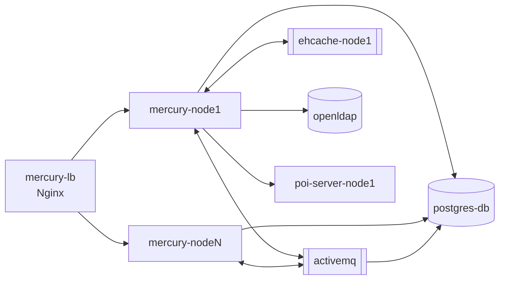

# mercury-docker – obrazy Docker i wykresy Helm

| | |
|---|---|
| Lokalizacja | `D:\workspace\git\mercury-docker` |
| Typ | Projekt ogólny IntelliJ (`mercury-docker.iml`), nie jest projektem Maven |
| Wersja serwera | `3.0.3.2.11` |
| Źródła | `github.com/IBPM-S-A/mercury-docker`, `github.com/SciSoftwareSlawomirCichy/mercury-docker` |

Definicje obrazów i kompozycji Docker do uruchomienia Mercury DB jako pojedynczego węzła
lub klastra, oraz wykres Helm dla Kubernetes. Obrazy wydań ostatecznych są publikowane w Docker Hub
w przestrzeni `ibpm/`. Obrazy robocze trafiają do Nexusa (`nexus.scisoftware.local:5000`, repozytorium
`docker-hosted`).

## Obrazy

| Katalog | Obraz | Baza | Opis |
|---|---|---|---|
| `mercury-3.0` | `ibpm/mercury:mercury-hgdb-3.0.4.25` | CentOS 8 | Serwer Mercury DB (Tomcat z aplikacjami serwera). |
| `mercury-lb` | `ibpm/mercury-lb:mercury-hgdb-3.0` | CentOS 8 | Nginx jako reverse proxy i load balancer węzłów klastra. Zawiera centrum certyfikatów. |
| `postgresql` | `ibpm/postgres:mercury-hgdb-3.0` | `postgres:17.11` | Baza danych serwera i ActiveMQ. Od wydania 3.0.4.20 PostgreSQL 17 (wcześniej 14.24), wersję ustawia `ARG POSTGRES_VERSION`. Poprzednią wersję zachowuje tag `mercury-hgdb-3.0-pg14`. |
| `activemq` | `ibpm/activemq:mercury-hgdb-3.0` | – | Broker JMS do komunikacji między węzłami. |
| `ehcache` | `ibpm/ehcache:mercury-hgdb-3.0` | Oracle JDK 8 | Serwer Ehcache Clustered. Konfigurację wybierają zmienne `HGDB_NODE` (`node1`–`node3`) i `HGDB_NODES` (1–3). |
| `openldap` | `ibpm/openldap:mercury-hgdb-3.0` | – | Katalog użytkowników. |
| `poi-server` | `ibpm/poi-server:mercury-hgdb-3.0` | Oracle JDK 8 | Iron – POI Excel Server: import i eksport danych w formacie xlsx. Węzeł wybiera zmienna `HGDB_NODE`. |

## Kompozycje

| Katalog | Węzły Mercury | Usługi |
|---|---|---|
| `mercury-single-node` | 1 | `mercury` (LB), `postgres-db`, `activemq`, `openldap`, `ehcache-node1`, `poi-server-node1`, `mercury-node1` |
| `mercury-two-node-cluster` | 2 | jak wyżej, z `ehcache-`, `poi-server-` i `mercury-node1..2` |
| `mercury-three-node-cluster` | 3 | jak wyżej, z `ehcache-`, `poi-server-` i `mercury-node1..3` |

Każdy węzeł ma własne wolumeny `mercury-upload-N` i `mercury-lucene-N` (indeksy Lucene).
Katalogi `activemq` i `poi-server` mają też własne, pomocnicze kompozycje do uruchomienia
pojedynczej usługi z bazą PostgreSQL.

**Sesje HTTP w klastrze (zadanie 227, obraz od 3.0.4.25).** LB (nginx) rozkłada żądania round-robin, więc logowanie FORM do GUI
(`mercury-gui-registry`, `mercury-ws-app`) wymaga replikacji sesji między węzłami (Tomcat Cluster). Kompozycje dwu- i trzywęzłowa
ustawiają w każdym węźle `TOMCAT_CLUSTER_MEMBERS` (nazwy hostów wszystkich węzłów po przecinku, razem z samym węzłem, np.
`mercury-node1,mercury-node2,mercury-node3`; `HOST_NAME` musi być na liście), a port replikacji to `TOMCAT_CLUSTER_PORT`
(domyślnie 4000, tylko między węzłami). Przy każdym starcie `bin/mercury-server.sh` (`initTomcatCluster`) sprawdza listę i klasę
`org.mercury.gui.auth.ClusterFormAuthenticator` w `mercury-gui-core`, wstawia element `Cluster` do `server.xml` (szablon
`conf/cluster.xml.docker-init`, członkostwo statyczne, `ReplicationValve` bez `.html`) i tworzy deskryptory
`conf/Catalina/localhost/mercury-gui-registry.xml` oraz `mercury-ws-app.xml` (szablon `conf/context-form-cluster.xml.docker-init`,
`landingPage` aplikacji). Błąd konfiguracji albo brak klasy przerywa start węzła: bez klasy Tomcat uruchomiłby aplikację bez
uwierzytelniania. Pusty `TOMCAT_CLUSTER_MEMBERS` (jeden węzeł, chart Helm) wyłącza replikację. Opis dla użytkowników: strona
`Cluster_sessions` serwisu hgdb.org (EN, PL).

## Helm

`charts/mercury-single-node` (wersja wykresu 0.1.0, `appVersion` 3.0.4.25, Kubernetes ≥ 1.16)
wdraża ten sam zestaw usług co kompozycja jednowęzłowa: ConfigMap, PV/PVC, PostgreSQL,
OpenLDAP, Ehcache, ActiveMQ, POI Server, węzeł Mercury i load balancer.
`charts/README.md` opisuje dodanie sekretu do rejestru `docker.io`.
Kolejność startu pilnują `initContainers` `wait-for-dependencies` (szablon `_helpers.tpl`) w szablonach 07, 08 i 09, jak `depends_on` w kompozycji. Szablony mają `resources.requests` pamięci z `values.yaml` (`mercuryNode` 4 Gi, JVM `-Xmx4098m`), bez `limits`, żeby scheduler rozkładał pody po workerach (obs. 165).
Wykres używa wolumenów NFS (sekcja `nfsVolumes`, nazwy PV stałe, więc jedno wydanie na klaster) i startuje od razu na PostgreSQL 17, więc migracja danych go nie dotyczy (obs. 162). Sprawdzony 2026-11-12 na klastrze kubeadm (Kubernetes 1.30, 3 węzły, NFS na masterze), szczegóły i znane ograniczenie (brak kolejności startu, obs. 165) w instrukcji na stronie `Kubernetes_installation` serwisu hgdb.org (EN, PL).

## PostgreSQL 17 i migracja danych

Wsparcie PostgreSQL 14 kończy się 2026-11-12, więc od wydania 3.0.4.20 obraz bazy jest oparty na
PostgreSQL 17.11, a sterownik JDBC w obrazach serwera i ActiveMQ to pgjdbc 42.7.14.
Katalog danych PostgreSQL nie jest zgodny między wersjami głównymi, więc istniejące instalacje muszą
zmigrować dane przed pierwszym startem na nowych obrazach. Robi to skrypt `bin/postgres-migrate.sh`
(dump `pg_dumpall` w kontenerze starej wersji, odtworzenie w nowej, porównanie liczby wierszy tabel,
`vacuumdb`; stary katalog zostaje do wycofania zmian). Procedura jest w `postgresql/README.md`
i na stronie `PostgreSQL_upgrade` w serwisie hgdb.org (EN, PL).

W kompozycjach dwu- i trzywęzłowej `postgres-db` startuje z `max_connections=400` (pule JDBC do 200
połączeń na węzeł), zob. [limit połączeń w klastrze](../postgresql-max-connections-klaster.md).
Szablon `context.xml.docker-init` ustawia `defaultAutoCommit="false"` dla `jdbc/MercuryDB`
i `jdbc/MercuryDBCommon` (wymaga tego `AbstractDAO.commitTransaction`).

## Licencja

Przy pierwszym uruchomieniu serwer generuje 30-dniowy klucz próbny. Klucz produkcyjny
wydaje IBPM S.A. na prośbę wysłaną na `mercury-key-registration@ibpm.pro`.

Źródło: `mercury-docker/README.md`, `mercury-docker/postgresql/README.md` i README poszczególnych katalogów.
