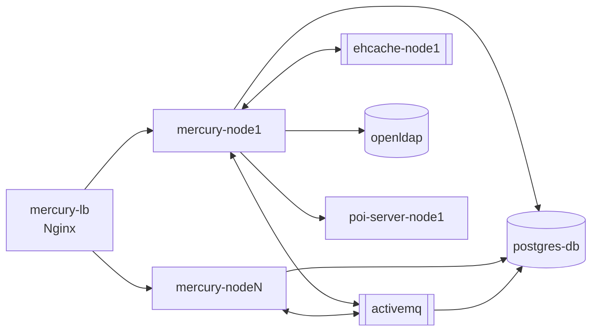

# mercury-docker – obrazy Docker i wykresy Helm

| | |
|---|---|
| Lokalizacja | `D:\workspace\git\mercury-docker` |
| Typ | Projekt ogólny IntelliJ (`mercury-docker.iml`), nie jest projektem Maven |
| Wersja serwera | `3.0.3.2.11` |
| Źródła | `github.com/IBPM-S-A/mercury-docker`, `github.com/SciSoftwareSlawomirCichy/mercury-docker` |

Definicje obrazów i kompozycji Docker do uruchomienia Mercury DB jako pojedynczego węzła
lub klastra, oraz wykres Helm dla Kubernetes. Obrazy wydań ostatecznych są publikowane w Docker Hub
w przestrzeni `ibpm/`. Obrazy robocze trafiają do Nexusa (`nexus.scisoftware.local:5000`, repozytorium
`docker-hosted`).

## Obrazy

| Katalog | Obraz | Baza | Opis |
|---|---|---|---|
| `mercury-3.0` | `ibpm/mercury:mercury-hgdb-3.0.4.45` | AlmaLinux 9 | Serwer Mercury DB (Tomcat z aplikacjami serwera). Własny Eclipse Temurin 17 w `/opt/mercury-3.0/java`. |
| `mercury-lb` | `ibpm/mercury-lb:mercury-hgdb-3.0` | AlmaLinux 9 | Nginx jako reverse proxy i load balancer węzłów klastra. Zawiera centrum certyfikatów. |
| `postgresql` | `ibpm/postgres:mercury-hgdb-3.0` | `postgres:17.11` | Baza danych serwera i ActiveMQ. Od wydania 3.0.4.20 PostgreSQL 17 (wcześniej 14.24), wersję ustawia `ARG POSTGRES_VERSION`. Poprzednią wersję zachowuje tag `mercury-hgdb-3.0-pg14`. |
| `activemq` | `ibpm/activemq:mercury-hgdb-3.0-5.19.12` | Eclipse Temurin 17 (UBI 9) | Broker JMS do komunikacji między węzłami (ActiveMQ 5.19.12). Opcjonalny `jetty.xml` przez ConfigMap `activemq.jettyConfigMap` w chartach. |
| `ehcache` | `ibpm/ehcache:mercury-hgdb-3.0-3.10.8` | Eclipse Temurin 17 (UBI 9) | Serwer Ehcache Clustered (kit 3.10.8, Terracotta 5.9.5). Konfigurację wybierają zmienne `HGDB_NODE` (`node1`–`node3`) i `HGDB_NODES` (1–3). |
| `openldap` | `ibpm/openldap:mercury-hgdb-3.0` | – | Katalog użytkowników. |
| `poi-server` | `ibpm/poi-server:mercury-hgdb-3.0` | Eclipse Temurin 17 (UBI 9) | Iron – POI Excel Server: import i eksport danych w formacie xlsx. Węzeł wybiera zmienna `HGDB_NODE`. |

## Kompozycje

| Katalog | Węzły Mercury | Usługi |
|---|---|---|
| `mercury-single-node` | 1 | `mercury` (LB), `postgres-db`, `activemq`, `openldap`, `ehcache-node1`, `poi-server-node1`, `mercury-node1` |
| `mercury-two-node-cluster` | 2 | jak wyżej, z `ehcache-`, `poi-server-` i `mercury-node1..2` |
| `mercury-three-node-cluster` | 3 | jak wyżej, z `ehcache-`, `poi-server-` i `mercury-node1..3` |

Każdy węzeł ma własne wolumeny `mercury-upload-N` i `mercury-lucene-N` (indeksy Lucene).
Katalogi `activemq` i `poi-server` mają też własne, pomocnicze kompozycje do uruchomienia
pojedynczej usługi z bazą PostgreSQL.

**Sesje HTTP w klastrze (zadanie 227, obraz od 3.0.4.25).** LB (nginx) rozkłada żądania round-robin, więc logowanie FORM do GUI
(`mercury-gui-registry`, `mercury-ws-app`) wymaga replikacji sesji między węzłami (Tomcat Cluster). Kompozycje dwu- i trzywęzłowa
ustawiają w każdym węźle `TOMCAT_CLUSTER_MEMBERS` (nazwy hostów wszystkich węzłów po przecinku, razem z samym węzłem, np.
`mercury-node1,mercury-node2,mercury-node3`; `HOST_NAME` musi być na liście), a port replikacji to `TOMCAT_CLUSTER_PORT`
(domyślnie 4000, tylko między węzłami). Przy każdym starcie `bin/mercury-server.sh` (`initTomcatCluster`) sprawdza listę i klasę
`org.mercury.gui.auth.ClusterFormAuthenticator` w `mercury-gui-core`, wstawia element `Cluster` do `server.xml` (szablon
`conf/cluster.xml.docker-init`, członkostwo statyczne, `ReplicationValve` bez `.html`) i tworzy deskryptory
`conf/Catalina/localhost/mercury-gui-registry.xml` oraz `mercury-ws-app.xml` (szablon `conf/context-form-cluster.xml.docker-init`,
`landingPage` aplikacji). Błąd konfiguracji albo brak klasy przerywa start węzła: bez klasy Tomcat uruchomiłby aplikację bez
uwierzytelniania. Pusty `TOMCAT_CLUSTER_MEMBERS` (jeden węzeł, chart Helm) wyłącza replikację. Opis dla użytkowników: strona
`Cluster_sessions` serwisu hgdb.org (EN, PL).
**SSO (zadanie 96).** Aplikacje z logowaniem FORM (`mercury-ws-app`, `mercury-gui-registry`, `mercury-gui-auth`) dzielą logowanie: `server.xml.docker-init` ma znacznik `TOMCAT_SSO_VALVE`, a `bin/mercury-server.sh` (`initTomcatSsoValve`) wstawia valve `ClusterSingleSignOn` (gdy ustawiono `TOMCAT_CLUSTER_MEMBERS`; stan SSO jest replikowany, więc logowanie i wylogowanie działa między węzłami) albo zwykły `SingleSignOn` (jeden węzeł). `ClusterSingleSignOnListener` nie trafia do `server.xml` (brak domyślnego konstruktora, Tomcat by nie wystartował). Deskryptor `conf/Catalina/localhost/mercury-gui-auth.xml` powstaje razem z pozostałymi (strona startowa `/ui/home`).

**Kolejność startu i nadzór (zadania 96 i 211e).** W kompozycjach dwu- i trzywęzłowej węzły SLAVE zależą od `mercury-node1` z `condition: service_healthy` (healthcheck `curl -f`), a w chartach trójwęzłowym init `wait-for-master` czeka na HTTP 200, więc pierwszy klucz licencji i inne zapisy początkowe wykonuje MASTER. Charty mają `startupProbe`, `livenessProbe` i `readinessProbe` dla wszystkich komponentów (węzeł Mercury: `NodeMonitorRest/load`), a kompozycje `restart: unless-stopped`; `process.sh` kończy kontener, gdy JVM padnie (obserwacja 202). Węzły `mercury` w obu chartach mają adnotację `checksum/config` (zmiana ConfigMapy restartuje pody przy `helm upgrade`).

**CMIS Basic i klient OAuth.** Skrypt `postgresql/docker-entrypoint-initdb.d/02-init-ldap-tables.sql` zakłada dwóch klientów OAuth: `GIUSoapUIClient` i `GIUPortalClient`. Domyślny `mercury.properties` (`mercury.cmis.security.oauthClientId` i `...Secret`) wskazuje `GIUPortalClient`, więc puste `CMIS_OAUTH_CLIENT_ID` i `CMIS_OAUTH_CLIENT_SECRET` (`cmisOauthClientId` i `cmisOauthClientSecret` w chartach) oznaczają klienta domyślnego. Domyślny sekret trzeba zmienić w produkcji (panel `mercury-gui-auth`, `/ui/oauth`; zmiana sekretu aktualizuje pozycje konfiguracji i unieważnia tokeny).

**LDAP (obraz `scisoftware/openldap`, repozytorium `docker-openldap`).** Konta z `ou=Technical` (np. `FrontendAccount`, konto realmu) mają odczyt drzewa, ale nie haseł (`userPassword`, `sambaNTPassword`: `none` w regule `olcAccess`); konta z `ou=Admins` zarządzają katalogiem zamiast `cn=Manager`. Reguły działają od inicjalizacji bazy; w istniejącej instalacji wymagają `slapmodify` przy zatrzymanym `slapd` (baza `cn=config` nie przyjmuje zmian online).

## Helm

Są dwa wykresy (wersja wykresów 0.1.0, `appVersion` 3.0.4.33, Kubernetes ≥ 1.16):

| Wykres | Co wdraża | Wolumeny NFS |
|---|---|---|
| `charts/mercury-single-node` | to samo co kompozycja jednowęzłowa: ConfigMap, PV/PVC, PostgreSQL, OpenLDAP, Ehcache, ActiveMQ, POI Server, węzeł Mercury i load balancer | PV `mercurysinglenode-*` |
| `charts/mercury-three-node-cluster` | to samo co kompozycja trzywęzłowa: `mercury-node1` (MASTER), `mercury-node2` i `mercury-node3` (SLAVE), dla każdego własny `ehcache-nodeN`, `poi-server-nodeN` i wolumeny `poi-server-N`, `mercury-upload-N`, `mercury-lucene-N` (ścieżka NFS z wartości plus `-N`); wspólne: PostgreSQL (`max_connections` 400), ActiveMQ, OpenLDAP, load balancer | PV `mercurythreenode-*` |

`charts/README.md` opisuje dodanie sekretu do rejestru `docker.io` oraz wykres trzywęzłowy.
Kolejność startu pilnują `initContainers` `wait-for-dependencies` (szablon `_helpers.tpl`), jak `depends_on` w kompozycji. W wykresie trzywęzłowym węzły 2 i 3 czekają dodatkowo na odpowiedź HTTP węzła 1 (`/mercury-ws-app/rest/openapi.json`, samo otwarcie portu nie wystarcza, bo Tomcat otwiera 8080 przy inicjalizacji), żeby MASTER wystartował pierwszy, a load balancer czeka na trzy węzły. Usługi węzłów publikują port 4000 (replikacja sesji Tomcat Cluster; bez niego GUI po zmianie węzła prosi o ponowne logowanie).
Szablony mają `resources.requests` i `limits` pamięci z `values.yaml` (węzeł Mercury 5 Gi / 6 Gi, Terracotta 1536 Mi / 3 Gi, PostgreSQL 1 Gi / 2 Gi, ActiveMQ 768 Mi / 1536 Mi, POI 768 Mi / 5 Gi, JVM Mercury `-Xmx4098m`) oraz miękką anty-afiniczność (`affinity`), żeby pody rozkładały się po workerach (obs. 165).
Wykresy używają wolumenów NFS (sekcja `nfsVolumes`, nazwy PV stałe, więc jedno wydanie każdego wykresu na klaster; PV obu wykresów się nie zderzają) i startują od razu na PostgreSQL 17, więc migracja danych ich nie dotyczy (obs. 162).

**Wymagania klastra Kubernetes** (decyzja autora, 2026-11-21; jedna kompozycja naraz, obie razem się nie mieszczą):

| | `mercury-single-node` | `mercury-three-node-cluster` |
|---|---|---|
| Master | 4 GB RAM | 4 GB RAM |
| Workery | 2 × 8 GB RAM (na mniejszych problem z serwerem POI) | co najmniej 4 × 8 GB RAM |
| Dysk workera | 64 GB (128 GB nie trzeba) | 64 GB |
| Dysk mastera | system i dodatkowy dysk co najmniej 256 GB na NFS | tak samo |

Klaster autora (2026-11-21, Kubernetes 1.30, containerd 2.2): master 4 vCPU / 3,4 GiB, `k8s-worker1` i `k8s-worker2` po 4 vCPU / 7,2 GiB, `k8s-worker3` 4 vCPU / 7,2 GiB, `k8s-worker4-ai` 16 vCPU / 15 GiB; NFS na masterze (`/srv/nfs/kubedata`, dysk 196 GB; dysk systemowy 62 GB). Wykres jednowęzłowy sprawdzono 2026-11-12, trzywęzłowy 2026-11-21 (3.0.4.33, kopia i odtwarzanie indeksu pod obciążeniem, restart serwera). Instrukcja dla użytkowników (wymagania, kroki instalacji, `containerd-nexus.sh` dla rejestru po HTTP, `kubeadm token create --print-join-command`, klaster trzech węzłów) jest na stronie `Kubernetes_installation` serwisu hgdb.org (EN, PL).

## PostgreSQL 17 i migracja danych

Wsparcie PostgreSQL 14 kończy się 2026-11-12, więc od wydania 3.0.4.20 obraz bazy jest oparty na
PostgreSQL 17.11, a sterownik JDBC w obrazach serwera i ActiveMQ to pgjdbc 42.7.14.
Katalog danych PostgreSQL nie jest zgodny między wersjami głównymi, więc istniejące instalacje muszą
zmigrować dane przed pierwszym startem na nowych obrazach. Robi to skrypt `bin/postgres-migrate.sh`
(dump `pg_dumpall` w kontenerze starej wersji, odtworzenie w nowej, porównanie liczby wierszy tabel,
`vacuumdb`; stary katalog zostaje do wycofania zmian). Procedura jest w `postgresql/README.md`
i na stronie `PostgreSQL_upgrade` w serwisie hgdb.org (EN, PL).

W kompozycjach dwu- i trzywęzłowej `postgres-db` startuje z `max_connections=400` (pule JDBC do 200
połączeń na węzeł), zob. [limit połączeń w klastrze](../postgresql-max-connections-klaster.md).
Szablon `context.xml.docker-init` ustawia `defaultAutoCommit="false"` dla `jdbc/MercuryDB`
i `jdbc/MercuryDBCommon` (wymaga tego `AbstractDAO.commitTransaction`).

## Licencja

Przy pierwszym uruchomieniu serwer generuje 30-dniowy klucz próbny. Klucz produkcyjny
wydaje IBPM S.A. na prośbę wysłaną na `mercury-key-registration@ibpm.pro`. Od zadania 96 klucz serwera jest w bazie (`IGO_DA_LICENSE_KEYS`, tworzona przez Hibernate przy `hbm2ddl.auto=update`; pierwszy klucz zapisuje tylko MASTER) z plikiem `mercury.license.file` jako rezerwą i kopią `.bak`; aktualizacja z formularza `/admin/license` w `mercury-ws-app`. Panel `mercury-gui-auth` ma własny klucz w `MRC_LDAP_LICENSE_KEYS` (tworzona przez aplikację).

Źródło: `mercury-docker/README.md`, `mercury-docker/postgresql/README.md` i README poszczególnych katalogów.
