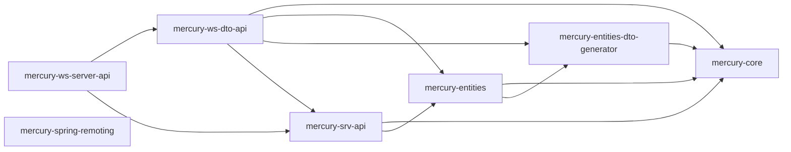

# mercury-lib – Mercury Main Library

| | |
|---|---|
| Lokalizacja | `D:\workspace\git\mercury-lib` |
| GAV | `io.hgdb.mercury:mercury-lib:3.0.4-SNAPSHOT` (pom) |
| Java | 1.8 |
| Opis z POM | Zbiór głównych komponentów systemu bazy danych Mercury DB. |

Biblioteki współdzielone przez serwer (`mercury`) i klientów (`hgdb-client-open`,
`mercury-client`, `mercury-cmd`). Definiują model encji i kontrakty usług.

## Moduły

| Moduł | Nazwa | Pliki Java (main / test) | Główne pakiety | Opis |
|---|---|---|---|---|
| `mercury-core` | Core | 500 / 32 | `pro.ibpm.mercury.entities`, `.attrs`, `.exceptions` | Abstrakcje i klasy narzędziowe: bazowe typy encji, atrybuty, wyjątki. Nie zależy od innych modułów. |
| `mercury-entities-dto-generator` | Entities DTO Generator | 9 / 0 | `pro.ibpm.mercury.entities` | Generator źródeł i kompilacji klas DTO na podstawie klas encji. |
| `mercury-entities` | Entities | 210 / 2 | `pro.ibpm.mercury.entities`, `.values` | Implementacje encji. Część źródeł jest generowana do `src/main/generated`. |
| `mercury-srv-api` | SRV API | 181 / 13 | `pro.ibpm.mercury.logic`, `pro.ibpm.mercury.business` | Interfejsy warstwy logiki (logic) i biznesu (business). |
| `mercury-ws-dto-api` | WS DTO API | 330 / 4 | `pro.ibpm.mercury.ws`, `pro.ibpm.mercury.dto` | Obiekty transportowe (DTO) usług SOAP, częściowo generowane. |
| `mercury-ws-server-api` | WS Server API | 75 / 3 | `pro.ibpm.mercury.ws`, `org.mercury.ws.server` | Interfejsy usług SOAP i REST (CXF). |
| `mercury-spring-remoting` | Spring remoting | 10 / 1 | `org.spring4hgdb.remoting.httpinvoker` | Kopia wycofanego ze Springa HTTP invokera, potrzebna do zdalnych wywołań klient–serwer. |

## Zależności wewnętrzne



## Budowanie

```bash
mvn clean install -Dmercury.static.version=3.0.2.0.2 [-Dmaven.test.skip] [-Ddatabse.provider=ORACLE]
```

- `install.sh` instaluje biblioteki dla wszystkich dostawców baz do `repo/io/hgdb/mercury`.
- `deploy.sh` publikuje je do repozytorium zdalnego (Nexus SCI Software).
- `up_major_version.sh` i `up_minor_version.sh` podnoszą wersję (`major_version.txt`, `minor_version.txt`).
- Wygenerowane źródła usuwa się ręcznie: `mercury-entities/src/main/generated/pro`, `mercury-ws-dto-api/src/main/generated/pro`.

Źródło: `mercury-lib/README.md`.
