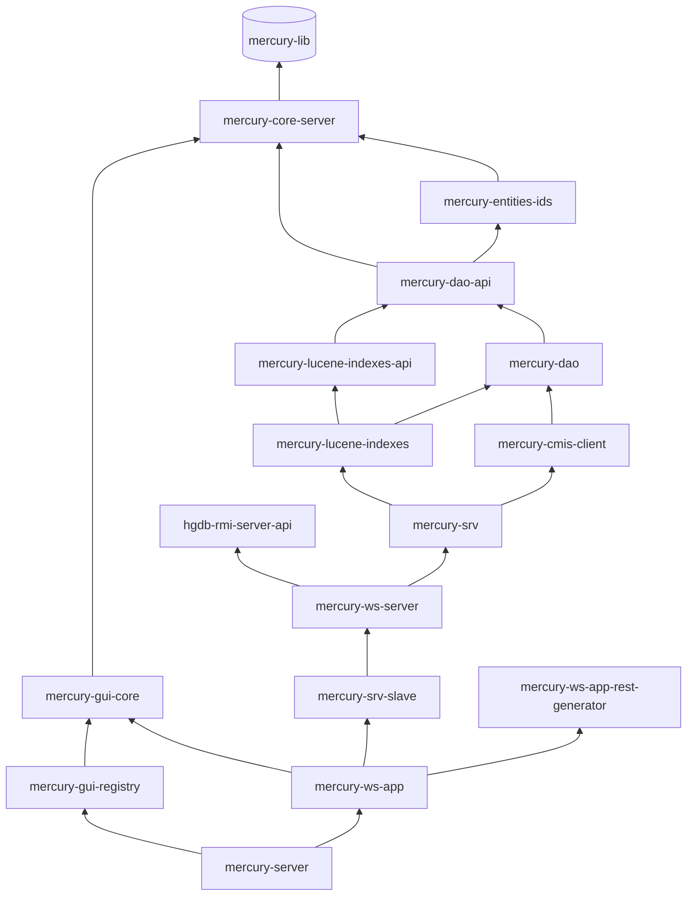

# mercury – Mercury DB (serwer)

| | |
|---|---|
| Lokalizacja | `D:\workspace\git\mercury` |
| GAV | `io.hgdb:mercury:3.0.4.6` (pom) |
| Java | 1.8 |
| Opis z POM | System uniwersalnego źródła danych. |

Implementacja serwera Mercury DB: dostęp do danych, indeksowanie Lucene, logika biznesowa,
usługi SOAP/REST/RMI, GUI administracyjne i aplikacje WAR uruchamiane w Apache Tomcat.
Moduły mają GAV `io.hgdb.mercury:<moduł>:3.0.4.6`, chyba że w tabeli podano inaczej.

Wersja 3.0.4.2 zmienia format XML modelu obiektu MRC (przestrzenie nazw) i dodaje kontrolę wersji węzłów klastra.
Opis zmian i kolejność wdrożenia: [wydanie 3.0.4.2](../wydanie-3.0.4.2.md).

## Moduły

### Rdzeń serwera i dane

| Moduł | Typ | Java (main / test) | Opis |
|---|---|---|---|
| `mercury-core-server` | jar | 187 / 70 | Abstrakcje i klasy narzędziowe serwera: konektory (`pro.ibpm.mercury.connectors`), filtry, bazowe DAO. |
| `mercury-entities-ids` | jar | 59 / 18 | Sekwencje i generatory unikalnych identyfikatorów encji, predefiniowane atrybuty i wartości. |
| `mercury-dao-api` | jar | 92 / 1 | API warstwy DAO. |
| `mercury-dao` | jar | 195 / 32 | Implementacja DAO (Hibernate), filtry, cache DAO (`org.mercury.caches.dao`). |
| `mercury-mock` | jar | 90 / 30 | Generatory danych testowych serwera. |

### Wyszukiwanie i integracje

| Moduł | Typ | Java (main / test) | Opis |
|---|---|---|---|
| `mercury-lucene-indexes-api` | jar | 71 / 2 | API obsługi indeksów Lucene. |
| `mercury-lucene-indexes` | jar | 119 / 38 | Definicje indeksów, wyszukiwanie i budowanie zapytań Lucene (`org.mercury.lucene.search`, `.query`). |
| `mercury-cmis-client` | jar | 7 / 3 | Komunikacja z repozytoriami dokumentów CMIS (Alfresco, FileNet, SharePoint) przez Apache Chemistry OpenCMIS. |

### Logika biznesowa

| Moduł | Typ | Java (main / test) | Opis |
|---|---|---|---|
| `mercury-srv` | jar | 451 / 82 | Logika (logic) i biznes (business), obsługa JMS (`org.mercury.logic.jms`), dane biznesowe. Największy moduł serwera. |
| `mercury-srv-slave` | jar | 69 / 16 | Logika w trybie SLAVE: węzły klastra (`org.mercury.cluster.node`), serwer slave, rejestr. |

### Usługi sieciowe

| Moduł | Typ | Java (main / test) | Opis |
|---|---|---|---|
| `mercury-ws-server` | jar | 99 / 6 | Implementacje usług SOAP i RMI (CXF). |
| `mercury-ws-server-api20` | jar | 75 / 0 | API usług zgodne z Mercury 2.0 (kompatybilność wsteczna). |
| `mercury-ws-server-api20-generator` | jar | 7 / 2 | Generator interfejsów API 2.0 z interfejsów Mercury 3.0 (`mercury-ws-server-api`). |
| `mercury-ws-app-rest-generator` | jar | 14 / 6 | Generator usług REST na podstawie implementacji SOAP oraz specyfikacji OpenAPI 3.1 (`openapi.json`) z opisami usług, operacji i schematów. |
| `hgdb-rmi-server-api` | jar | 18 / 11 | API usług RMI (`org.spring4hgdb.remoting.rmi`). Używa go również klient `hgdb-multi-client`. |

### Aplikacje i GUI

| Moduł | Typ | Java (main / test) | Opis |
|---|---|---|---|
| `mercury-ws-app` | **war** | 225 / 6 | Główna aplikacja WWW serwera: usługi SOAP, REST i RMI, dokumentacja WADL, specyfikacja OpenAPI i Swagger UI (patrz „OpenAPI i Swagger UI”), bindingi serwera CMIS. |
| `mercury-gui-core` | jar | 78 / 11 | Baza aplikacji prezentacyjnych: Tomcat Realm łączący użytkowników z RDBMS i LDAP, OAuth 2.0. |
| `mercury-gui-registry` | **war** | 5 / 0 | GUI rejestru do zarządzania modułami Mercury DB (JSP/JSTL). |
| `license-registry` | **war** | 1 / 1 | Rejestr licencji. GAV: `io.hgdb:license-registry`. |
| `ROOT` | **war** | 0 / 0 | Aplikacja ROOT Tomcata. GAV: `io.hgdb:ROOT:3.0.1-SNAPSHOT`, bez rodzica. |

### Narzędzia i dystrybucja

| Moduł | Typ | Java (main / test) | Opis |
|---|---|---|---|
| `hgdb-tools` | jar | 3 / 3 | Narzędzia, m.in. obsługa licencji (`org.hgdb.tools.license`). |
| `hgdb-server-monitor` | jar | 1 / 0 | Monitoring pracy serwera. |
| `mercury-server` | jar | 0 / 0 | Testowy serwer Tomcat 8.0.32 z ActiveMQ, konfiguracją i bibliotekami. Baza wersji produkcyjnej. GAV: `io.hgdb:mercury-server`. |

## Zależności (uproszczone)



## OpenAPI i Swagger UI

Dokumentacja usług REST (zadanie 133, [etap 1](../../tasks/hgdb/133-Swagger-implementacja/etap-1-openapi-statyczne.md)):

- **Specyfikacja.** OpenAPI 3.1 powstaje przy budowie w `mercury-ws-app-rest-generator` (`exec-maven-plugin`, faza `compile`)
  razem z kontrolerami `XxxRest`. Wynik jest zapisywany w repozytorium: `mercury-ws-app/src/main/resources/openapi/openapi.json`
  (kontrolery w `src/main/generated`). Zapis jest deterministyczny. Raport braków opisów: `mercury-ws-app-rest-generator/target/openapi-doc-report.txt`.
- **Źródła opisów.** Opisy operacji i parametrów to `@WSDLDocumentation` na interfejsach `I*Action` w `mercury-lib`
  (`mercury-ws-server-api`) w stałym formacie: opis, blok `Parametry:`, blok `Zwraca:`. Opisy klas i pól schematów to Javadoc,
  zapisywany podczas budowy modułów `mercury-lib` i `mercury-lucene-indexes-api` do `META-INF/mercury/schema-docs.json` w jarach
  (`SchemaDocsGenerator`). Klasa `XxxDto` dziedziczy opisy encji `Xxx`, a pole `id` bez opisu dostaje opis domyślny.
- **Serwowanie.** `OpenApiController` (`mercury-ws-app`) udostępnia `GET /rest/openapi.json` z sekcją `servers` zależną od ścieżki
  kontekstu. Swagger UI (webjar `org.webjars:swagger-ui` 5.32.0) działa pod `/swagger-ui/`, a jego konfiguracja i style są w
  `mercury-ws-app/src/main/webapp/swagger-ui-config/swagger-initializer.js`.
- **Kontrolery `*ExtRest`.** Ręcznie pisane kontrolery na logicznym JSON-ie sprawy opisuje klasa
  `org.mercury.rest.server.actions.ExtRestOpenApi` (refleksja, bez bibliotek swagger-core). `OpenApiController` dokleja ich
  operacje do statycznej specyfikacji (32 operacje w 4 usługach). Opisy pochodzą z `@WSDLDocumentation` na interfejsach `I*ExtRest`.
- **Zabezpieczenie.** Specyfikacja deklaruje schemat OAuth 2.0 `mercuryOAuth` (przepływ `password`, `POST /rest/token`) i wymaga go
  dla wszystkich operacji. Filtr `OAuthFilter` chroni ścieżki `/rest/service/**` (wzorzec z `mercury-security-config-db-1.0.0.xml`),
  a `/rest/openapi.json` i `/swagger-ui/` są publiczne.
- **Jackson.** Serwer używa Jacksona 2.18.2 (`jackson.version` i `jackson.databind.version` w `mercury/pom.xml`; wcześniej 2.13.2).
  `org.mercury.gui.listeners.JacksonConstraintsListener` (`web.xml` obu aplikacji) znosi domyślny limit długości napisu w odczycie
  JSON-a (20 000 000 znaków od Jacksona 2.15), żeby duże wartości LOB w sprawach nadal się odczytywały.

## Dokumentacja OpenAPI typu sprawy

Dokumentacja struktury typu sprawy i usług na sprawach (zadanie 133, [etap 2](../../tasks/hgdb/133-Swagger-implementacja/etap-2-openapi-typy-spraw.md)).
Status: [TASK.md](../../tasks/hgdb/133-Swagger-implementacja/TASK.md#status-zadania-stan-na-2026-10-20).

- **Endpointy** (`org.mercury.rest.server.actions.CaseTypeOpenApiController`, w przeciwieństwie do `/rest/openapi.json` niepubliczne):
  `GET /rest/openapi/types.json` (kody typów spraw), `GET /rest/openapi/types/{kod}/versions.json` (wersje typu) i
  `GET /rest/openapi/types/{kod}.json[?v=3.1|typeId=123]` (specyfikacja OpenAPI 3.1 typu, bez parametrów ostatnia wersja). Wersja `v`
  to `version.versionMinor` (samo `3` oznacza `3.0`), a `typeId` ma pierwszeństwo. Nieznany typ albo wersja daje 404.
- **Dostęp.** Token OAuth (`Authorization: Bearer`) albo sesja użytkownika zalogowanego formularzem (`/mercury-ws-app/login/`),
  więc specyfikację da się oglądać w przeglądarce. Bez jednego i drugiego 401.
- **Schemat typu.** Budowany bezpośrednio z `TypeCase`/`TypeParam`/`ParamDefinition` (bez generowania klas Javy): logiczny JSON sprawy,
  pierwsza właściwość `mrcCaseHeader`, sprawy zależne jako `$ref` (ochrona przed cyklami, limit `Context.maxDepthResult`).
  Typy zależne starszej wersji głównej: wersja obowiązująca w chwili jej początku (`fromDate`/`toDate`), a bez takiej ostatnia.
- **Usługi per typ** (`CaseTypeServicesController`): `POST /rest/service/types/{kod}/{operacja}` ustawia w kontekście parametr
  `requestContext.caseAsType` (`ContextRequestProperties.RequestContextes.CASE_AS_TYPE`) i deleguje do usług `*ExtRest`.
  Zapis sprawy istniejącej w innym typie jest migracją (nowa wersja sprawy w typie docelowym, stara ze statusem `Z`).
  Operacje: `find`, `findFirst`, `loadSampleByTypeCode`, `searchByLuceneId`, `findByPKProperty`, `save`, `initModel`, `findByIdList`,
  `findByGroupCaseIds`, `loadLastUpdatedByTypeCodes`, `loadSubCase`, `loadSubCaseList`, `searchInDB`, `searchByParams`, `searchByQuery`,
  `search/searchByQuery`, `search/explainPlanSearchByQuery`, `search/dateMetricQuery`, `history/findByCaseId`,
  `history/findByCaseIdAllVersions`. Dla list i wyników stronicowanych typ trafia do zapytania, dla pojedynczej sprawy jest
  sprawdzany w odpowiedzi.
- **Język opisów.** Teksty typu w postaci `${klucz}` (etykiety, opisy, nazwy opcji słowników) są tłumaczone przez `IResourceLogic`
  na język z `?lang=` (`pl`, `en-GB`, `en_GB`; na stronach Swagger UI parametr `?l=`, jak na stronie głównej, z aliasem `?lang=`), a bez niego z nagłówka `Accept-Language` albo języka systemu. Specyfikacja ma
  `info.x-language`, a przetłumaczone nazwy opcji trafiają do `x-enumNames` (obok `enum` z wartościami). Klucz bez tłumaczenia jest
  pomijany, a tytuł pola wraca do `recomendedLabel`, potem do nazwy definicji.
- **Strona wyboru typu.** `/swagger-ui/types.html` (z wyborem języka opisów; `types.html?l=de` ustawia język, a `index.html?spec=…&l=de` dopisuje `lang` do adresu specyfikacji typu) (chroniona logowaniem w `web.xml`) pokazuje typy i ich wersje, a kliknięcie otwiera
  Swagger UI z `index.html?spec=../rest/openapi/types/{kod}.json[?typeId=…]`. Pliki `swagger-initializer.js` i `types.html` mają
  `Cache-Control: no-store` (osobne mapowania `mvc:resources` przed `/swagger-ui/**`). „Try it out” dla `POST /rest/service/…`
  wymaga tokenu (przycisk Authorize, przepływ `password`).
- **Pułapki.** `@Transactional` w klasach skanowanych w kontekście serwletu (`moduleDb-3.0-servlet.xml`) nie działa, więc
  `CaseTypeOpenApiService` używa `TransactionTemplate` (`transactionManagerDefault`). Klucz pamięci podręcznej odpowiedzi HTTP
  uwzględnia `caseAsType`. `save` kończy się `NullPointerException` na pustych tablicach w sprawach zależnych (obserwacje 46–49
  w [obserwacjach](../obserwacje.md)).

## Budowanie

```bash
mvn -U clean install -Dmaven.test.skip=true
mvn -U clean install -Dmaven.test.skip=true -Ddatabse.provider=ORACLE
```

Po instalacji biblioteki ładuje się do innych projektów skryptami:

```bash
./deploy.sh slawas mercury-webapps
./deploy-api.sh slawas mercury-webapps
./deploy-api.sh slawas mercury-client
./deploy-api.sh slawas hgdb-client-open
```

Uwagi do budowania serwera testowego (`mercury-server`):

- Instalacja kopiuje do `apache-tomcat` pliki WAR i jary `mercury*` oraz `hgdb*` w `apache-tomcat/mercury/lib`. Przed
  `mvn install` zatrzymaj Tomcata: przy uruchomionym serwerze krok `mercury-server` zakończył się błędem na etapie
  kasowania starych jarów (przypuszczenie: Windows blokuje jary używane przez Tomcata), choć pozostałe moduły zbudowały się poprawnie. Po instalacji usuń rozpakowane katalogi
  `webapps/mercury-ws-app` i `webapps/mercury-gui-registry`, żeby Tomcat rozpakował nowe WAR-y.
- Biblioteki zewnętrzne w `apache-tomcat/mercury/lib` (np. Jackson) nie są aktualizowane przez instalację. Przy zmianie ich wersji
  podmień jary ręcznie, biorąc je z `mercury-server/target/dependency`.
- Maven pracuje w trybie offline (`MAVEN_ARGS=-o`). Nowe artefakty ściąga się osobno poleceniem `mvn dependency:get`.

## Pozostałe katalogi

- `docs/` – artykuły: metadane obiektów, DTO usług SOAP/REST, sekcje GUI, „Object vs Case”, Security Helper.
- `db/` – skrypty baz danych.
- `maven/` – pomocniczy POM `pl.slawas:install-jar` do instalacji jarów w lokalnym repozytorium. Nie należy do reaktora.
- `repo/` – lokalne repozytorium Maven projektu.
- `test-case-samples/` – przykładowe przypadki testowe.

Jakość kodu: SonarCloud, projekt `io.hgdb:mercury`.
