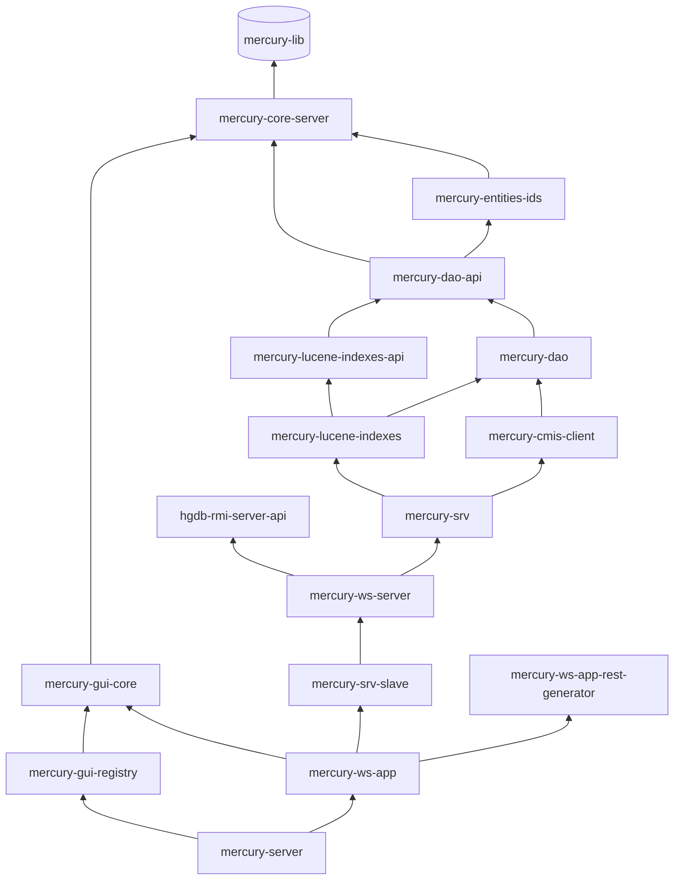

# mercury – Mercury DB (serwer)

| | |
|---|---|
| Lokalizacja | `D:\workspace\git\mercury` |
| GAV | `io.hgdb:mercury:3.0.4.1` (pom) |
| Java | 1.8 |
| Opis z POM | System uniwersalnego źródła danych. |

Implementacja serwera Mercury DB: dostęp do danych, indeksowanie Lucene, logika biznesowa,
usługi SOAP/REST/RMI, GUI administracyjne i aplikacje WAR uruchamiane w Apache Tomcat.
Moduły mają GAV `io.hgdb.mercury:<moduł>:3.0.4.1`, chyba że w tabeli podano inaczej.

## Moduły

### Rdzeń serwera i dane

| Moduł | Typ | Java (main / test) | Opis |
|---|---|---|---|
| `mercury-core-server` | jar | 187 / 70 | Abstrakcje i klasy narzędziowe serwera: konektory (`pro.ibpm.mercury.connectors`), filtry, bazowe DAO. |
| `mercury-entities-ids` | jar | 59 / 18 | Sekwencje i generatory unikalnych identyfikatorów encji, predefiniowane atrybuty i wartości. |
| `mercury-dao-api` | jar | 92 / 1 | API warstwy DAO. |
| `mercury-dao` | jar | 195 / 32 | Implementacja DAO (Hibernate), filtry, cache DAO (`org.mercury.caches.dao`). |
| `mercury-mock` | jar | 90 / 30 | Generatory danych testowych serwera. |

### Wyszukiwanie i integracje

| Moduł | Typ | Java (main / test) | Opis |
|---|---|---|---|
| `mercury-lucene-indexes-api` | jar | 71 / 2 | API obsługi indeksów Lucene. |
| `mercury-lucene-indexes` | jar | 119 / 38 | Definicje indeksów, wyszukiwanie i budowanie zapytań Lucene (`org.mercury.lucene.search`, `.query`). |
| `mercury-cmis-client` | jar | 7 / 3 | Komunikacja z repozytoriami dokumentów CMIS (Alfresco, FileNet, SharePoint) przez Apache Chemistry OpenCMIS. |

### Logika biznesowa

| Moduł | Typ | Java (main / test) | Opis |
|---|---|---|---|
| `mercury-srv` | jar | 451 / 82 | Logika (logic) i biznes (business), obsługa JMS (`org.mercury.logic.jms`), dane biznesowe. Największy moduł serwera. |
| `mercury-srv-slave` | jar | 69 / 16 | Logika w trybie SLAVE: węzły klastra (`org.mercury.cluster.node`), serwer slave, rejestr. |

### Usługi sieciowe

| Moduł | Typ | Java (main / test) | Opis |
|---|---|---|---|
| `mercury-ws-server` | jar | 99 / 6 | Implementacje usług SOAP i RMI (CXF). |
| `mercury-ws-server-api20` | jar | 75 / 0 | API usług zgodne z Mercury 2.0 (kompatybilność wsteczna). |
| `mercury-ws-server-api20-generator` | jar | 7 / 2 | Generator interfejsów API 2.0 z interfejsów Mercury 3.0 (`mercury-ws-server-api`). |
| `mercury-ws-app-rest-generator` | jar | 10 / 1 | Generator usług REST na podstawie implementacji SOAP. |
| `hgdb-rmi-server-api` | jar | 18 / 11 | API usług RMI (`org.spring4hgdb.remoting.rmi`). Używa go również klient `hgdb-multi-client`. |

### Aplikacje i GUI

| Moduł | Typ | Java (main / test) | Opis |
|---|---|---|---|
| `mercury-ws-app` | **war** | 222 / 4 | Główna aplikacja WWW serwera: usługi SOAP, REST i RMI, dokumentacja WADL, OpenAPI, bindingi serwera CMIS. |
| `mercury-gui-core` | jar | 77 / 10 | Baza aplikacji prezentacyjnych: Tomcat Realm łączący użytkowników z RDBMS i LDAP, OAuth 2.0. |
| `mercury-gui-registry` | **war** | 5 / 0 | GUI rejestru do zarządzania modułami Mercury DB (JSP/JSTL). |
| `license-registry` | **war** | 1 / 1 | Rejestr licencji. GAV: `io.hgdb:license-registry`. |
| `ROOT` | **war** | 0 / 0 | Aplikacja ROOT Tomcata. GAV: `io.hgdb:ROOT:3.0.1-SNAPSHOT`, bez rodzica. |

### Narzędzia i dystrybucja

| Moduł | Typ | Java (main / test) | Opis |
|---|---|---|---|
| `hgdb-tools` | jar | 3 / 3 | Narzędzia, m.in. obsługa licencji (`org.hgdb.tools.license`). |
| `hgdb-server-monitor` | jar | 1 / 0 | Monitoring pracy serwera. |
| `mercury-server` | jar | 0 / 0 | Testowy serwer Tomcat 8.0.32 z ActiveMQ, konfiguracją i bibliotekami. Baza wersji produkcyjnej. GAV: `io.hgdb:mercury-server`. |

## Zależności (uproszczone)



## Budowanie

```bash
mvn -U clean install -Dmaven.test.skip=true
mvn -U clean install -Dmaven.test.skip=true -Ddatabse.provider=ORACLE
```

Po instalacji biblioteki ładuje się do innych projektów skryptami:

```bash
./deploy.sh slawas mercury-webapps
./deploy-api.sh slawas mercury-webapps
./deploy-api.sh slawas mercury-client
./deploy-api.sh slawas hgdb-client-open
```

## Pozostałe katalogi

- `docs/` – artykuły: metadane obiektów, DTO usług SOAP/REST, sekcje GUI, „Object vs Case”, Security Helper.
- `db/` – skrypty baz danych.
- `maven/` – pomocniczy POM `pl.slawas:install-jar` do instalacji jarów w lokalnym repozytorium. Nie należy do reaktora.
- `repo/` – lokalne repozytorium Maven projektu.
- `test-case-samples/` – przykładowe przypadki testowe.

Jakość kodu: SonarCloud, projekt `io.hgdb:mercury`.
