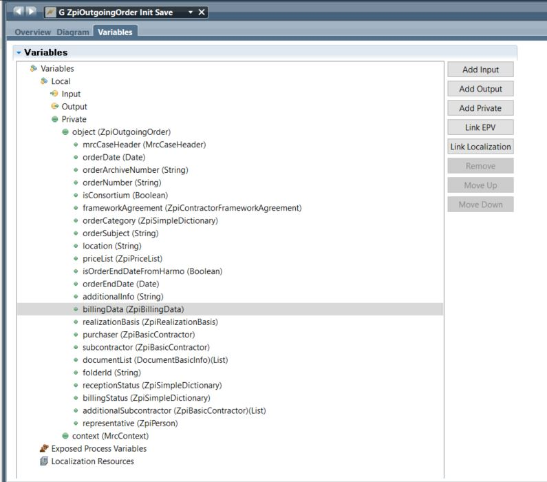

# [56] Problem z aktualizacją typu podczas zmniejszenia liczby parametrów

## Opis problemu

@kasprzyk zauważył, że gdy zmieniamy liczbę parametrów w obiekcie np. z 34 do 22, to pierwsze 22 ją zapisane prawidłowo, lecz reszta jest bezmyślnie doklejana. Jest to błąd bo pojawiają się duplikaty pól.

Obiekt obecnie (na poziomie klienta):

Lista parametrów po stronie Mercury:

### Komentarz @scichy

Nie udaje mi się zreprodukować problemu w Mercury 3.0. Za to zaobserwowałem ciekawy case:

Zadziałał mechanizm:

Tylko nie spodziewałem się w danym momencie takiego efektu - raczej może powinny być pozostałe wartości pól (street oraz checkParameter) ustawione na null

@lcichorek co o tym myślisz?

### Komentarz @lcichorek

Mam jeden pomysł. Można by w kontekście ustawić flagę np. `setNullIfNotExists` (albo jakoś inaczej, ładniej), która by oznaczała, że jeżeli nie uzupełniłem pól, to należy je ustawić na null.

### Komentarz 2 @scichy

Przydałoby się też opisać w artykule dokumentacji opisującym kontekst (obiekt Context) wszystkie dodatkowe 
fali/parametry które są w nim używane. Wtedy będzie wiadomo, że np. `setNullIfNotExists` jest dostępne i można z niego korzystać.
Parametr `setNullIfNotExists` powinien być ustawiany jako parametr w kategorii `ContextRequestProperties.
SaveRequestContext`.

