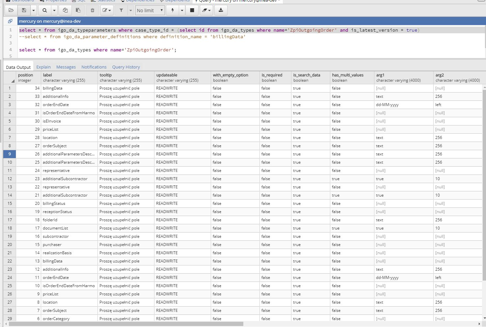
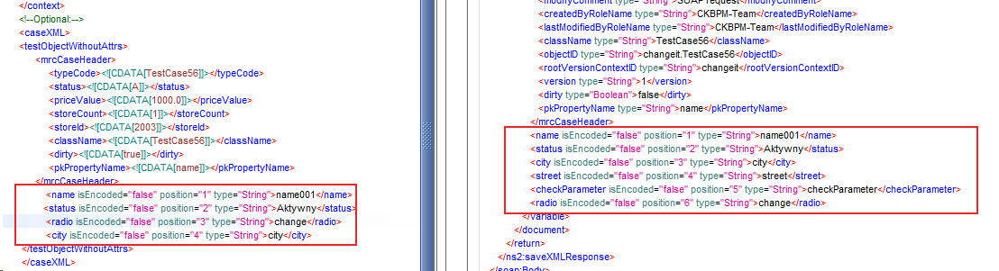
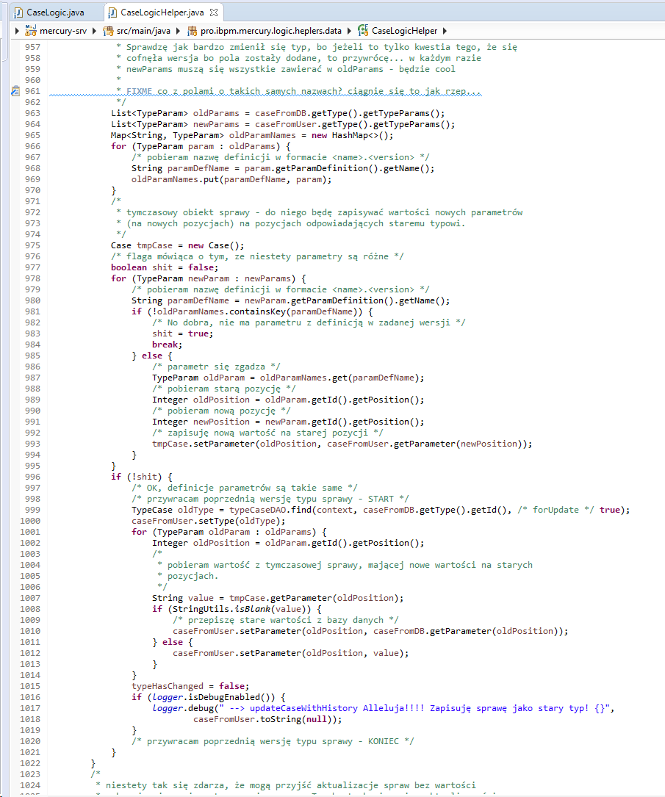

# [56] Problem z aktualizacją typu podczas zmniejszenia liczby parametrów

## Opis problemu

@kasprzyk zauważył, że gdy zmieniamy liczbę parametrów w obiekcie np. z 34 do 22, to pierwsze 22 ją zapisane prawidłowo, lecz reszta jest bezmyślnie doklejana. Jest to błąd bo pojawiają się duplikaty pól.

Obiekt obecnie (na poziomie klienta):

Lista parametrów po stronie Mercury:

### Komentarz @scichy

Nie udaje mi się zreprodukować problemu w Mercury 3.0. Za to zaobserwowałem ciekawy case:

Zadziałał mechanizm:

Tylko nie spodziewałem się w danym momencie takiego efektu - raczej może powinny być pozostałe wartości pól (street oraz checkParameter) ustawione na null

@lcichorek co o tym myślisz?

### Komentarz @lcichorek

Mam jeden pomysł. Można by w kontekście ustawić flagę np. `setNullIfNotExists` (albo jakoś inaczej, ładniej), która by oznaczała, że jeżeli nie uzupełniłem pól, to należy je ustawić na null.

### Komentarz 2 @scichy

Przydałoby się też opisać w artykule dokumentacji opisującym kontekst (obiekt Context) wszystkie dodatkowe 
fali/parametry które są w nim używane. Wtedy będzie wiadomo, że np. `setNullIfNotExists` jest dostępne i można z niego korzystać.
Parametr `setNullIfNotExists` powinien być ustawiany jako parametr w kategorii `ContextRequestProperties.
SaveRequestContext`.

## Rozpoznanie (2026-11-17)

**Flaga z komentarzy już istnieje, ale serwer jej nie czyta.**

- `ContextRequestProperties.SaveRequestContext.VALUE_IS_NULL_IF_FIELD_NOT_EXISTS_IN_REQUEST` (`mercury-lib/mercury-core`, klucz `saveRequestContext.valueIsNullIfFieldNotExisisInRequest`, wartość domyślna z `mercury.properties`: `mercury.saveRequestContext.valueIsNullIfFieldNotExisisInRequest.default`, w obrazach i przykładach `false`; literówka `Exisis` w nazwie jest historyczna).
- Pole `valueIsNullIfFieldNotExisisInRequest` jest w DTO `ContextSaveRequest` (`ccrto-openapi`) i w przykładach `context_sample.v1.{xml,json}`.
- Jest opisane w artykule dokumentacji o `Context` (docusaurus, `004_API/001_Context/index.mdx`, EN i PL).
- **W repozytorium `mercury` nie ma żadnego użycia** ani enumu, ani klucza (przeszukane `*.java` w `mercury`, `mercury-lib`, `hgdb-client-open`, `mercury-cmd`). Flaga jest więc zadeklarowana i udokumentowana, lecz nie działa.

**Gdzie to zadziała:** `CaseLogicHelperService` (`mercury-srv/.../org/mercury/logic/heplers/services/`), metoda aktualizacji ze zmianą typu (`updateCaseWithHistory`): (1) blok „przywracam poprzednią wersję typu” (ok. linii 690): puste wartości z żądania są zastępowane wartościami z bazy (`caseFromDB.getParameter(oldPosition)`), (2) blok „wypełnij nową sprawę wartościami ze starej” (ok. linii 820 i dalej) przy zmianie typu i tworzeniu nowej wersji. Komentarz w kodzie z 2019 r. („FIXME co z polami o takich samych nazwach?”, zmienna `shit`) dotyczy tego samego miejsca.

**Do rozstrzygnięcia przed kodem:**
1. Co znaczy „pole nie istnieje w żądaniu” po stronie serwera: pozycja nieustawiona (`null`) czy pusty tekst. Dziś `StringUtils.isBlank` traktuje je tak samo i przepisuje stare wartości.
2. Odtworzyć zgłoszenie testem (typ z 34 → 22 parametrami, zapis starszym i nowszym typem), bo w 3.0 duplikatów autor nie odtworzył, a pozostałe pola dostają stare wartości.
3. Zachowanie domyślne (`false`) zostaje jak dziś; `true` ustawia pola nieprzesłane na `null` w nowej wersji.

## Postęp (2026-11-17)

Decyzja autora: „pole nie istnieje w żądaniu” oznacza tylko pozycję nieustawioną (`null`). Gałąź `hgdb-056` w `mercury` (od `master` po `pull`) i w `docusaurus-hgdb`.

- **Kod (`mercury-srv`):** `CaseLogicHelper.mergeParameterValue(valueFromRequest, valueFromDb, nullIfNotInRequest)`; `CaseLogicHelperService.updateCaseWithHistory`, blok „przywracam poprzednią wersję typu”, czyta flagę `SaveRequestContext.VALUE_IS_NULL_IF_FIELD_NOT_EXISTS_IN_REQUEST.getContextValue(context)` (kontekst, a gdy brak, domyślna z `mercury.properties`).
  - flaga wyłączona (domyślnie): zachowanie bez zmian, pusta wartość z żądania (`null`, tekst pusty, same spacje) jest zastępowana wartością z bazy;
  - flaga włączona: pole nieustawione w żądaniu zostaje `null`, każda wartość ustawiona w żądaniu, także tekst pusty, nadpisuje wartość z bazy.
- **Poza zakresem (świadomie):** blok „zmiana tylko typu” (migracja wartości ze starej sprawy po definicjach) przepisuje wartości ze starej sprawy z założenia, niezależnie od żądania, więc flaga go nie dotyczy.
- **Testy:** `CaseParameterMergeTest` (4, jednostkowe, bez bazy) przechodzi (`mvn -o -pl mercury-srv`). **Brak testu scenariuszowego na bazie** (zmniejszenie z 34 do 22 parametrów): wymaga infrastruktury (Terracotta, ActiveMQ, `mercury-db-test`), którą uruchamia autor.
- **Dokumentacja:** artykuł o `Context` (docusaurus EN i PL) miał już wszystkie parametry `saveRequestContext.*` (zgodne z enumem); opis `valueIsNullIfFieldNotExisisInRequest` rozszerzony o zakres i zachowanie.
- **Do zrobienia:** (a) test scenariuszowy na bazie, (b) ustalić, czy klient `hgdb-client-open` powinien dostać metodę ustawiającą flagę (dziś jest tylko DTO `ContextSaveRequest` w `ccrto-openapi`), (c) obserwacje 171 i 170 oraz CMIS z Bearer (zadanie ma je objąć).

## Test scenariuszowy (2026-11-17)

`ReducedParamsScenario` (`mercury-srv/src/test/.../scenarios/`, zarejestrowany w `SrvTest` jako `reducedParamsScenario`) na bazie `mercury-db-test` (profil `scichy-test`, Terracotta 9510, ActiveMQ 51616): typ `TestCase56` zapisany z pełnym zestawem pól (name, status, city, street, checkParameter, radio), potem ten sam obiekt z mniejszym zestawem (bez `street` i `checkParameter`, `radio` zmienione na `change`).

- flaga wyłączona (domyślnie): `street=street`, `checkParameter=checkParameter` zostają ze starej wartości, `radio=change`; zachowanie jak dotąd;
- flaga włączona: `street=null`, `checkParameter=null`, `city=city`, `radio=change`.

**Pułapka scenariusza (nie błąd kodu):** zapis pomija sprawę (`SKIP`, `MrcCaseResultSaverCallable.saveCase`), jeśli nagłówek XML nie ma `<dirty>true</dirty>`; bez niego test nie widzi żadnej zmiany. Zmiana zestawu pól tworzy też nową wersję typu (`TestCase56.2`) przez wątek zależności.

Uruchomienie: `mvn -o test -pl mercury-srv -Dtest=SrvTest -Duser=scichy-test -Ddatabse.provider=POSTGRESQL`; w lokalnym `scichy-test/test.properties` dopisany klucz `test.skip.reducedParamsScenario=false` (plik w `.gitignore`; profil `scichy` autora bez klucza: **dopisz `test.skip.reducedParamsScenario=false` albo `true`**).

## Klient `hgdb-client-open` (2026-11-17)

Flagi zapisu klient przesyła jako parametry żądania w kontekście (`pro.ibpm.mercury.context.Context.requestProperties`, klucz `saveRequestContext.valueIsNullIfFieldNotExisisInRequest`); typowane DTO `ContextSaveRequest` z `ccrto-openapi` nie jest używane w tym przepływie. Do tej pory trzeba było znać enum `SaveRequestContext` z `mercury-lib` i zapisywać wartość tekstową.

- **Nowa klasa** `io.hgdb.mercury.client.cxf.context.SaveRequestFlags` w `hgdb-ws-client-cxf` (korzysta z niej także `hgdb-multi-client`, który zależy od tego modułu): `nullIfFieldNotInRequest(context, boolean)` (zwraca kontekst, można łączyć w łańcuch), `isNullIfFieldNotInRequest(context)` (`null`, gdy nie ustawiono: decyduje domyślna wartość serwera), `clearNullIfFieldNotInRequest(context)`.
- **Test:** `SaveRequestFlagsTest` (3, jednostkowe, bez serwera) przechodzi (`mvn -o -pl hgdb-ws-client-cxf` w `hgdb-client-open`).
- Gałąź `hgdb-056` w `hgdb-client-open` (niezacommitowane). Opis w docusaurus (artykuł o `Context`, EN i PL) uzupełniony o ten sposób ustawiania flagi.
- Zmiana nie wymaga zmiany `mercury-lib` ani `ccrto-openapi`, więc nie wymusza ich wydania; klient dostanie nowy numer przy kolejnym wydaniu.

## Obserwacja 171: miganie strony „Zapytania Lucene” (2026-11-17)

**Przyczyna (potwierdzona pomiarem):** stan monitora jest per węzeł, a odświeżanie strony szło przez balanser round-robin, więc kolejne żądania `state` trafiały na różne węzły: na zrzucie nagłówek `Węzeł: node3`, odczyt `node2` z pustymi statystykami. Pusta odpowiedź chowała tabele (`display: none`) i zerowała kafelki, a następna ją przywracała. Test na lokalnej kompozycji 3-węzłowej (REST `LuceneQueriesExtRest/getQueriesState`): bez `n` kolejne odpowiedzi to `node3, node1, node2, node3, node1, node2`; z `?n=node3` zawsze `node3`.

**Poprawki (`mercury-ws-app/src/main/webapp/pages/admin/`):**
- `lucene-queries.jsp`, `loggers.jsp`, `secretaries.jsp`: wywołania zaplecza dostają `?n=<węzeł, który wyświetlił stronę>` (zmienna `NODE` z modelu `nodeName`), więc balanser kieruje je do tego samego węzła. Odczyty i zmiany (poziom logowania, sekretarze) dotyczą więc węzła opisanego na stronie. Skutek uboczny: balanser ustawia ciasteczko `hgdb_node`, czyli przeglądarka zostaje przypięta do tego węzła (jak przy `?n=` w adresie); `?n=auto` kasuje przypięcie.
- `lucene-queries.jsp`: nowa zawartość tabel, kafelków i wykresów powstaje poza stroną (`DocumentFragment`) i zastępuje starą jednym ruchem (`replaceChildren`, z zapasowym wariantem dla starszych przeglądarek) dopiero po pobraniu próbki; `thead`, `tbody`, kafelki i wykresy SVG już nie są czyszczone przed budową nowych.
- Składnia skryptów sprawdzona (`node --check` po podstawieniu wartości JSP). Nie sprawdzone wzrokiem w przeglądarce: to zrobi autor na kompozycji lokalnej (3 węzły) albo na devopsie.

**Potwierdzenie autora (2026-11-17):** po zmianach strona „Zapytania Lucene” wygląda dobrze (obserwacja 171 ✅). Autor poprawił też `auth/inv_logon_error.jsp`: link „spróbuj ponownie” kierował do nieistniejącej strony (`${url}`), teraz `javascript:history.back()`; zmiana jest autora, poza zakresem moich zmian.

## Obserwacja 170: pierwsze logowanie kierowało na `types.html` (2026-11-17)

**Przyczyna (odtworzona bez przeglądarki, `curl` z czystym słoikiem ciasteczek przez LB na kompozycji 3-węzłowej):** zapisane żądanie, do którego Tomcat wraca po zalogowaniu, jest *note* sesji i nie jest replikowane (zadanie 227). Gdy `GET` strony chronionej (formularz) i `POST j_security_check` trafiają na różne węzły (round-robin), logujący węzeł nie zna zapisanego żądania i używa `landingPage`, a dla `mercury-ws-app` ustawiono tam `/swagger-ui/types.html` (`mercury-server.sh`). Dlatego „zawsze, nie ważne z którego linka”, a „po wylogowaniu poprawnie” to przypadek (ten sam węzeł). Test: oba żądania na jednym węźle: poprawny adres; `GET` na node1, logowanie na node2: `types.html`; round-robin bez przypięcia: 8 z 8 `types.html`. Nie przeglądarka ani sonda.

**Poprawki:**
- `ClusterFormAuthenticator` (`mercury-gui-core`): po wyświetleniu formularza kopiuje ścieżkę i parametry zapisanego żądania `GET` do replikowanych atrybutów sesji (`org.mercury.gui.auth.savedRequestUri` i `…savedRequestQuery`), a przy logowaniu, gdy węzeł nie ma zapisanego żądania, odtwarza je z atrybutów (`SavedRequest`); po logowaniu atrybuty są usuwane. Żądania inne niż `GET` i brak zapisanego adresu nadal kończą na `landingPage`.
- `mercury-docker` (`mercury-server.sh`): `landingPage` dla `mercury-ws-app` zmieniona z `/swagger-ui/types.html` na `/` (strona główna aplikacji), bo `types.html` jako domyślna strona po zalogowaniu wprost nie ma uzasadnienia.
- Dokumentacja (`Cluster_sessions`, EN i PL): po zalogowaniu użytkownik wraca na żądany adres; strona startowa tylko bez zapisanego adresu.
- **Sprawdzone na kompozycji 3-węzłowej (jar i skrypt w obrazie nakładkowym):** round-robin bez `n`: 8 z 8 poprawnie (`/admin/lucene-queries`), `GET` node1 → logowanie node2 poprawnie, adres z parametrami (`/files/uploadSystemFile?l=de`) zachowany, wejście wprost na stronę logowania: `/`; po zalogowaniu `/admin/loggers` zwraca 200.
- **Nie ma testu jednostkowego** (klasa zależy od obiektów Tomcata `Request` i `Session`); wymagane ponowne wydanie `mercury` (jar w `common.loader`) i obrazu `mercury-docker`.
